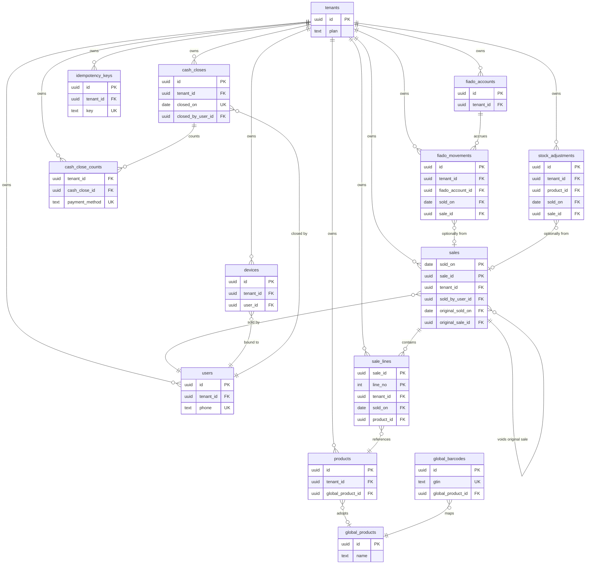

# Database Design — POS SaaS MVP

## 1. Purpose

This document is the single, authoritative PostgreSQL design contract for the POS SaaS MVP (bodegas and minimarkets). It fixes the complete schema — 14 tables, whole-schema conventions, the entity-relationship diagram, per-table definitions grouped by owning module, and the cross-cutting prose for what diagrams cannot express (row-level security, partitioning, offline sync and reconciliation) — before any migration is written.

**This is a planning contract, not executable SQL.** No DDL scripts — no table-creation or table-alteration statements, no migration files — appear anywhere in this document. Every column, constraint, and index is expressed as Markdown; implementers translate this contract into versioned migrations, and reviewers verify intent against the document itself.

**Who this is for:**

- **The S0-2 field list** — this document publishes the domain field list for every table: money as integer cents, quantities as exact numerics, and no business data in JSONB outside the two homes stated in Section 2.
- **Sprint 1+ implementers** — migrations, the Go data layer, and RLS policies are built against this fixed target.
- **Reviewers** — tenant isolation, money handling, and offline-sync safety can be verified here, before code exists.

**Relationship to other documents.** `ARCHITECTURE.md` remains the system reference, read **as amended** by Section 8: the `tenders` table is superseded by `sales.payment_method`, and `sync_events` is merged into `idempotency_keys` (the binding table set is 14, not 15). Re-syncing `ARCHITECTURE.md` and `SPRINTS.md` is a separate registered follow-up; this document does not edit them.

**How this document is organized** (progressive disclosure — conventions before tables, tables before the prose that references them):

| # | Section | Content |
|---|---------|---------|
| 1 | Purpose | this section — what this contract is and who it serves |
| 2 | Conventions | twelve whole-schema rules every table section assumes |
| 3 | ERD | the 14 entities in three clusters, with every required relationship |
| 4 | Per-table definitions | 14 table sections in seven module groups |
| 5 | RLS prose | FORCE RLS, pooler-safe tenant context, policy fragments, grant matrix |
| 6 | Partitioning prose | monthly RANGE partitions on `sales`, pre-creation, safety nets |
| 7 | Sync & reconciliation prose | idempotency claims, cursor pull, LWW, silent reconciliation |
| 8 | Binding amendments | every binding decision traced to named schema elements |
| 9 | Not in this version | the deferred list, matching the spec's Out of Scope exactly |

## 2. Conventions

Twelve rules bind the whole schema. Each rule is referenced from the table sections that rely on it (for example, "2.6" for the tenant_id index rule); each table section in Section 4 states only what is table-specific.

### 2.1 Names

Plural snake_case table names — exactly the 14 tables enumerated in Section 3, matching `ARCHITECTURE.md` **as amended** (`tenders` and `sync_events` are superseded; see Section 8). Columns are snake_case. Suffix discipline is load-bearing:

| Suffix | Meaning | Examples |
|--------|---------|----------|
| `*_cents` | money, integer cents | `price_cents`, `total_cents`, `amount_cents` |
| `*_id` | foreign key / reference | `tenant_id`, `product_id` |
| `*_at` | timestamp | `created_at`, `received_at` |
| `*_hash` | digest | `password_hash`, `payload_hash` |

Index and constraint naming: indexes are `{table}_{column}_idx` (multi-column: `{table}_{col1}_{col2}_idx`), UNIQUE constraints `{table}_{column}_key`, primary keys `{table}_pkey`, CHECK constraints `{table}_{column}_chk`. Sections 4–7 reference constraints by these names.

### 2.2 Identifiers — UUIDv7 everywhere

Every identifier is a UUIDv7; generation is split by row origin:

| Row origin | Tables | Generator |
|------------|--------|-----------|
| Device-originated | `products`, `sales`, `fiado_accounts`, `fiado_movements`, `stock_adjustments`, `cash_closes` | client, at creation/close time (offline-first: the id exists before the server ever sees the row) |
| Server-born | `tenants`, `users`, `devices`, `idempotency_keys`, `global_products`, `global_barcodes` | server |
| No surrogate id | `sale_lines` | composite PK `(sale_id, line_no)` |

`cash_close_counts` takes whichever PK shape its Section 4 entry pins; if a surrogate id is chosen there, it is client-generated UUIDv7 like the rest of its batch.

Time-ordered v7 gives B-tree insert locality; UUIDv4 is rejected because it fragments indexes. One id type across the whole schema avoids mixed-type joins. **Platform pin: PostgreSQL 15 minimum** — every pinned feature in this contract exists by PG15. Native `uuidv7()` exists only from PostgreSQL 18, so server-side UUIDv7 generation is application-side (Go) or a custom SQL function — never a dependency on a native `uuidv7()`.

### 2.3 Money — BIGINT integer cents

Every money column is `BIGINT` with the `*_cents` suffix; there is no NUMERIC and no floating-point money anywhere in the schema. Fractional-cent results from fractional quantities are rounded exactly once, client-side, half-up, at close: the client rounds each line total to integer cents and freezes it on the line, and the sale total is the sum of rounded line totals. The server stores frozen values and never recomputes money.

### 2.4 Quantities — NUMERIC(10,3)

Quantities are exact `NUMERIC(10,3)` — a 0.125 kg sale is representable without floating-point error. Deltas are signed (`qty_delta`). Quantities are not money; the integer-cents rule does not apply to them.

### 2.5 Timestamps — TIMESTAMPTZ and placement

TIMESTAMPTZ only — never timestamp-without-tz. Placement:

| Column | Placement |
|--------|-----------|
| `created_at` | every table — client time on device-originated rows (preserved by the server), server time on server-born rows |
| `updated_at` | exactly the two mutable device-synced tables, `products` and `fiado_accounts` — client mutation time; this is the LWW comparator (Section 7). Append-only tables carry none. |
| `received_at` | server-assigned audit timestamp on every device-originated table (`products`, `sales`, `fiado_accounts`, `fiado_movements`, `stock_adjustments`, `cash_closes`); child tables share their parent's transaction and carry none; never a sync comparator |
| `sold_on` | DATE — the client-assigned business date at close; sync delay never moves a sale into another day, cash close, or partition |
| `deleted_at` | `products` only — soft-delete tombstone |

Net effect: append-only device-originated tables carry exactly `created_at` + `received_at`; the mutable device-synced tables add `updated_at`; server-born tables carry `created_at` only.

### 2.6 tenant_id

`tenant_id UUID NOT NULL` referencing `tenants.id`, on all 11 tenant-scoped tables (`cash_close_counts` included). Every tenant-scoped table has at least one index leading with `tenant_id`, and all secondary composite indexes lead with `tenant_id`. Spec-pinned keys stand as pinned — for example `sale_lines (sale_id, line_no)` and `cash_close_counts (cash_close_id, payment_method)` — and the composite-FK companion indexes on `sale_lines`, `fiado_movements`, and `stock_adjustments` deviate only under 2.7's documented-justification clause.

### 2.7 Foreign keys

ON DELETE RESTRICT uniformly — the model has no hard deletes (`products` are tombstoned; ledgers are append-only). Every FK column is covered by an index; PostgreSQL does not auto-index FK columns. Composite-FK companions to the partitioned `sales` parent — `(sold_on, sale_id)` on `sale_lines`, `fiado_movements`, and `stock_adjustments` — mirror the parent's key shape instead of leading with `tenant_id`. This is a documented, justified deviation: each such index exists solely to service its composite FK, and its shape aligns with the parent key and partition pruning; tenant-scoped access paths stay covered by the 2.6 indexes.

### 2.8 Bounded value sets — TEXT + CHECK

Bounded value sets — `payment_method`, `kind`, `source`, `plan` — are TEXT columns with CHECK constraints. CHECK over ENUM (cheaper evolution) and over a lookup table (no 16th table). Evolving a value set is a documented one-line change note in this contract.

### 2.9 JSONB boundary — exactly two homes

JSONB appears in exactly two homes: `products.attributes` (elastic tenant product properties) and `global_products.attributes` (elastic global catalog structure). All core fields — identity, `tenant_id`, money, stock quantities, GTIN, UoM, timestamps — are typed columns everywhere else. Serialization outside the two homes (the idempotency response snapshot) is TEXT, never JSONB.

### 2.10 Digests

argon2id for credentials (`users.password_hash`, `devices.pin_hash`); SHA-256 hex for `idempotency_keys.payload_hash`.

### 2.11 Row-level security

FORCE RLS plus `SET LOCAL app.current_tenant_id` per transaction, taken from the JWT, on the 11 tenant-scoped tables. Pre-auth exceptions: signup sets the tenant context to the newly created tenant; login reads `users` through a dedicated `pos_auth` policy. `tenants` (the registry) and the two global tables live outside tenant RLS, and tenant roles hold zero grants on the global tables (API-mediated reads only). Full policy and grant prose: Section 5.

### 2.12 Append-only

Five tables are append-only: `sales`, `sale_lines`, `fiado_movements`, `stock_adjustments`, `cash_close_counts`. Enforcement is both revoked UPDATE/DELETE grants and BEFORE UPDATE OR DELETE trigger guards — history is never edited in place. `idempotency_keys` is deliberately not append-only: its claim lifecycle needs UPDATE, and its retention needs DELETE via the maintenance role (Sections 5 and 7).

## 3. Entity relationship diagram

Three clusters. **Registry**: `tenants` — global, outside tenant RLS. **Tenant-scoped**: the 11 business tables — FORCE RLS by tenant (Section 5). **Platform-curated global**: `global_products`, `global_barcodes` — outside tenant RLS; tenants reach them read-only through the API. The only cross-cluster edge is `products` → `global_products` (optional adoption).

The diagram carries key attributes only (PK / FK / UK markers); full column sets, CHECK bodies, and indexes are defined in Section 4. `cash_close_counts` shows its pinned UNIQUE `(cash_close_id, payment_method)`; its primary-key shape is pinned in its own Section 4 entry.



**Boundary — not database entities.** Client-side IndexedDB stores — the cart, the pending event queue, the catalog subset, favorites — are client-only state; favorites have no server table or column by design. Product photos live in object storage; the database stores URL strings only (`products.photo_url`).

**What the diagram cannot express.** CHECK bodies, RLS policies, partitioning, and grants have no Mermaid notation; they are specified in Sections 4–7, with pointers from each table section.

## 4. Per-table definitions

Fourteen table sections in seven module groups, in dependency order: **Identity** → **Catalog** → **Ledger** → **Fiado** → **Cash close** → **Sync/API** → **Platform-curated global**. Every section uses one canonical format: columns first (type, nullability, default, notes), then primary key, foreign keys, unique/check constraints, indexes, mutability, RLS where relevant, and the binding decision trace. The Section 2 conventions are assumed and not restated.

### `tenants` — Identity (registry)

The tenant registry row: one per business. Anchors every `tenant_id` in the schema.

| Column | Type | Null | Default | Notes |
|--------|------|------|---------|-------|
| id | UUID | NOT NULL | — | server-generated UUIDv7 (2.2) |
| name | TEXT | NOT NULL | — | business display name |
| plan | TEXT | NOT NULL | 'free' | information-only pricing tier; billing is out of scope |
| created_at | TIMESTAMPTZ | NOT NULL | — | server time; registry rows are not device-synced |

**Primary key**: `tenants_pkey` on (id).
**Foreign keys**: none — the registry root; every tenant-scoped table references this table.
**Unique / Check**: `tenants_plan_chk` — plan IN ('free', 'standard', 'pro').
**Indexes**: primary key only; no non-key column has an access path that needs one.
**Mutability**: server-managed (created at signup). No `updated_at` (2.5): the registry is not device-synced, and MVP has no plan changes.
**RLS**: none — the registry lives outside tenant RLS (Section 5) and `pos_app` holds no SELECT on it.
**Decision trace**: binding decision 1 (shared database with `tenant_id` isolation); decision 7 (plan is a single field — no billing tables); spec Open Item 13 (minimal shape: no legal/RUC fields, no settings JSONB per 2.9).

**Delta note — SDD stitch-admin-prompts (D1 ADOPTED, binds P2 login Admin; docs-only, NO DDL en este cambio).** Documentación de columna futura para el backend, anclada a la tabla `tenants` (columnas :172-177):

```text
tenants.master_password_hash      TEXT NOT NULL   -- argon2id (2.10; patrón users.password_hash :196; sufijo *_hash :44);
                                                   --  registry-owned, fuera del RLS de tenant (:183-184, :591);
                                                   --  DDL bajo owner/migration (:622); backfill vía admin-setup (IDA-1.2);
                                                   --  tenant sin hash -> 401 genérico (IDA-2.3)
```

Contrato exacto según design §12 del cambio `stitch-admin-prompts`. La UI (P2 Login-2 Admin) espera este contrato y no lo inventa (regla D4): el submit de 'INGRESAR' se liga a `POST /auth/admin-login` cuando el backend aterrice.

### `users` — Identity (tenant-scoped/RLS)

Cashier/owner accounts. One account = one tenant in the MVP: `phone` is globally UNIQUE because `POST /auth/login` carries no tenant discriminator — the tenant arrives only inside the token.

| Column | Type | Null | Default | Notes |
|--------|------|------|---------|-------|
| id | UUID | NOT NULL | — | server-generated UUIDv7 (2.2) |
| tenant_id | UUID | NOT NULL | — | FK → tenants.id, ON DELETE RESTRICT |
| phone | TEXT | NOT NULL | — | login identity; globally UNIQUE (Open Item 9) |
| password_hash | TEXT | NOT NULL | — | argon2id (2.10) |
| created_at | TIMESTAMPTZ | NOT NULL | — | server time (signup) |

**Primary key**: `users_pkey` on (id).
**Foreign keys**: `tenant_id` → `tenants.id` ON DELETE RESTRICT (2.7).
**Unique / Check**: `users_phone_key` — UNIQUE (phone), global, not tenant-scoped.
**Indexes**: `users_tenant_id_idx` on (tenant_id) — the 2.6 tenant-leading rule; the `users_phone_key` backing index serves the login lookup.
**Mutability**: server-managed (auth lifecycle; created at signup). No `updated_at` (2.5 — server-born table).
**RLS**: tenant-scoped; the login lookup runs through the dedicated `pos_auth` policy (Section 5).
**Decision trace**: decision 1; spec Open Item 9 (phone + argon2id password on users; the device PIN and offline session live on `devices`, not here).
**Descriptive columns**: none beyond the anchored set — phone identifies the cashier for login and the JWT `user_id`; no pinned flow consumes a display name, so none is invented.

### `devices` — Identity (tenant-scoped/RLS)

A phone bound to one cashier (S1-3). Carries the offline-unlock credentials: the PIN hash and the offline session expiry — an expired access token with a valid PIN still unlocks the POS offline for at least 7 days.

| Column | Type | Null | Default | Notes |
|--------|------|------|---------|-------|
| id | UUID | NOT NULL | — | server-generated UUIDv7 (2.2) |
| tenant_id | UUID | NOT NULL | — | FK → tenants.id, ON DELETE RESTRICT |
| user_id | UUID | NOT NULL | — | FK → users.id — the bound cashier |
| pin_hash | TEXT | NOT NULL | — | argon2id (2.10) — device unlock credential, not a user credential |
| offline_session_valid_until | TIMESTAMPTZ | NOT NULL | — | offline PIN session expiry: set at bind to bind-time + at least 7 days, refreshed on every online authentication; the client refuses offline unlock once passed |
| created_at | TIMESTAMPTZ | NOT NULL | — | server time (bind) |

**Primary key**: `devices_pkey` on (id).
**Foreign keys**: `tenant_id` → `tenants.id` ON DELETE RESTRICT; `user_id` → `users.id` ON DELETE RESTRICT (2.7).
**Unique / Check**: none beyond the PK.
**Indexes**: `devices_tenant_id_user_id_idx` on (tenant_id, user_id) — the 2.6 tenant-leading rule; serves the bound-cashier lookup and covers both FK columns.
**Mutability**: server-managed, mutable by auth lifecycle (re-bind, PIN change, session refresh) — explicitly not append-only; the only updated columns are `user_id` (re-bind), `pin_hash`, and `offline_session_valid_until`, through the auth surface (`pos_app` UPDATE on devices, Section 5 grant matrix).
**RLS**: tenant-scoped.
**Decision trace**: decision 1; spec Open Item 9 (PIN + offline session are device concerns); SPRINTS S1-3 (offline PIN session valid 7+ days).
**Descriptive columns**: none beyond the anchored set — the bound user identifies the device; no pinned flow consumes a device label, so none is invented.

### `products` — Catalog (tenant-scoped/RLS)

A sellable item in one tenant's catalog. Carries its own identity, price, stock projection, and optional lineage pointer to a platform-curated global product. Mutated by the client (LWW), soft-deleted by tombstone, and referenced by sale lines and stock adjustments.

| Column | Type | Null | Default | Notes |
|--------|------|------|---------|-------|
| id | UUID | NOT NULL | — | client-generated UUIDv7 (2.2); device-originated |
| tenant_id | UUID | NOT NULL | — | FK → tenants.id, ON DELETE RESTRICT |
| name | TEXT | NOT NULL | — | display name; tenant-scoped uniqueness with soft-delete predicate |
| gtin | TEXT | NULL | — | barcode (TEXT preserves leading zeros across GTIN-8/12/13/14); tenant-scoped uniqueness with soft-delete + non-null predicates |
| price_cents | BIGINT | NOT NULL | — | selling price, integer cents (2.3) |
| uom | TEXT | NOT NULL | — | unit of measure (e.g. 'unit', 'kg') |
| stock | NUMERIC(10,3) | NOT NULL | 0 | server-maintained projection — additive SUM of stock_adjustments.qty_delta; NO CHECK >= 0 (offline oversell accepted, OI-10); projection writes NEVER modify updated_at (MD-11) |
| photo_url | TEXT | NULL | — | object-storage URL; photos are NOT database entities (Section 3 boundary note) |
| attributes | JSONB | NULL | — | JSONB home #1 (2.9) — elastic tenant product properties (e.g. brand, expiry days) |
| global_product_id | UUID | NULL | — | FK → global_products.id — adoption pointer, the ONLY tenant-side linkage (F13); NULL for tenant-created products |
| created_at | TIMESTAMPTZ | NOT NULL | — | client time (device-originated, 2.5) |
| updated_at | TIMESTAMPTZ | NOT NULL | — | client mutation time — the LWW comparator (2.5, Section 7); server-side stock projection writes NEVER modify this column (MD-11) |
| received_at | TIMESTAMPTZ | NOT NULL | — | server-assigned audit timestamp (2.5); never a sync comparator |
| deleted_at | TIMESTAMPTZ | NULL | — | soft-delete tombstone (OI-7); non-null marks the row as evicted from the active catalog |

**Primary key**: `products_pkey` on (id).
**Foreign keys**: `tenant_id` → `tenants.id` ON DELETE RESTRICT (2.7); `global_product_id` → `global_products.id` ON DELETE RESTRICT (2.7) — adoption pointer; lineage only, never a live dependency (F13).
**Unique / Check**:
- `products_tenant_gtin_key` — UNIQUE (tenant_id, gtin) WHERE deleted_at IS NULL AND gtin IS NOT NULL — tenant-scoped barcode uniqueness, reclaimable after tombstone.
- `products_tenant_name_key` — UNIQUE (tenant_id, name) WHERE deleted_at IS NULL — tenant-scoped name uniqueness, reclaimable after tombstone.

**Indexes**:
- `products_tenant_id_idx` on (tenant_id) — the 2.6 tenant-leading rule.
- `products_tenant_updated_at_idx` on (tenant_id, updated_at) — NO partial predicate: tombstoned rows MUST be pullable by the sync cursor (Section 7). Serves the GET /sync/cursor watermark.
- `products_tenant_global_product_id_idx` on (tenant_id, global_product_id) — serves the adoption lookup.
- The `products_tenant_gtin_key` and `products_tenant_name_key` backing indexes (partial, WHERE deleted_at IS NULL) serve their respective unique constraints.

**Mutability**: mutable-LWW + soft-delete. Client mutations (name, price_cents, gtin, uom, photo_url, attributes) write updated_at as the LWW comparator; the server preserves client mutation-time and never overwrites it with server time. Server-side stock projection writes (applying stock_adjustments deltas onto stock) NEVER modify updated_at (MD-11). stock is excluded from PATCH payloads and from LWW comparison — stock converges exclusively via additive signed deltas (Section 7 damage bound). Soft-delete: setting deleted_at is the only delete operation; the row persists for historical sale_lines references and sync tombstone pulls. PATCH is additive-only: new attributes can be added, never removed via PATCH.
**RLS**: tenant-scoped (Section 5).
**Decision trace**: decision 2 (JSONB boundary — attributes is home #1); decision 8 (LWW = client mutation-time); OI-7 (tombstones); OI-10 (no stock >= 0 CHECK); OI-11 (RESTRICT FK on products referenced by sale_lines); F13 (adoption rule); MD-11 (stock/updated_at interaction).
**Adoption rule (F13)**: when a tenant adopts a global product, the server copies the global row's data into the tenant's columns (name, gtin, uom, attributes) at adoption time and sets global_product_id. After adoption the tenant row is self-owned — edits to the tenant row do not propagate back to the global row, and edits to the global row do not propagate to adopted tenant rows. The pointer is lineage, never a live dependency.

**Delta note — SDD stitch-admin-prompts (D11 DEFERRED; docs-only, NO DDL).** La pantalla de catálogo (P8) NO renderiza columna de márgenes ni alertas de costo (ADCt-4.1): `products` no tiene `cost_cents` (:234-249) y "net profit"/compras son epics Later (SPRINTS.md §11; fuera de esta versión, §9 :825). Delta futuro registrado:

```text
products.cost_cents BIGINT NULL     -- + campo PATCH aditivo + cálculo de margen comercial;
                                    --  la gestión de precio (price_cents) SÍ está en scope (ADCt-2.3);
                                    --  purchases/suppliers y net profit: Later epics (SPRINTS.md §11, :825)
```

La gestión de precios (price_cents) sigue siendo la única edición de precio en esta versión.

### `stock_adjustments` — Catalog (tenant-scoped/RLS)

An append-only signed-delta log driving the products.stock projection. Every stock movement — sale, void, or manual correction — writes exactly one row here. The invariant `products.stock = SUM(stock_adjustments.qty_delta)` (per product, per tenant) is the audit anchor for the entire stock model.

| Column | Type | Null | Default | Notes |
|--------|------|------|---------|-------|
| id | UUID | NOT NULL | — | client-generated UUIDv7 (2.2); device-originated |
| tenant_id | UUID | NOT NULL | — | FK → tenants.id, ON DELETE RESTRICT |
| product_id | UUID | NOT NULL | — | FK → products.id, ON DELETE RESTRICT |
| qty_delta | NUMERIC(10,3) | NOT NULL | — | signed quantity change (2.4): sale = negative, void = positive, manual = either direction |
| source | TEXT | NOT NULL | — | origin of the delta; CHECK ('sale', 'void', 'manual') (2.8) |
| reason | TEXT | NULL | — | human-readable note for manual corrections; NULL for sale/void sources |
| sold_on | DATE | NULL | — | companion to sale_id for composite FK to sales (MD-9); NULL for manual adjustments |
| sale_id | UUID | NULL | — | composite FK → sales(sold_on, sale_id); NULL for manual adjustments; CHECK pair-nullity with sold_on |
| created_at | TIMESTAMPTZ | NOT NULL | — | client time (device-originated, 2.5) |
| received_at | TIMESTAMPTZ | NOT NULL | — | server-assigned audit timestamp (2.5); never a sync comparator |

**Primary key**: `stock_adjustments_pkey` on (id).
**Foreign keys**: `tenant_id` → `tenants.id` ON DELETE RESTRICT (2.7); `product_id` → `products.id` ON DELETE RESTRICT (2.7); composite (`sold_on`, `sale_id`) → `sales(sold_on, sale_id)` ON DELETE RESTRICT (2.7, MD-9 pattern) — nullable sale linkage, F19.
**Unique / Check**:
- `stock_adjustments_source_chk` — source IN ('sale', 'void', 'manual') (2.8).
- `stock_adjustments_sale_link_chk` — CHECK ((sold_on IS NULL) = (sale_id IS NULL)) — pair-nullity for the nullable composite sale linkage (MD-9, F19).
**Indexes**:
- `stock_adjustments_tenant_id_product_id_idx` on (tenant_id, product_id) — the 2.6 tenant-leading rule; serves the per-product delta aggregation and covers the product_id FK column.
- `stock_adjustments_sold_on_sale_id_idx` on (sold_on, sale_id) — composite-FK companion index per Convention 7's documented-justification clause (2.7): this index exists solely to service the composite FK to the partitioned sales parent and aligns with the parent's (sold_on, sale_id) key shape and partition pruning; tenant-scoped access paths stay covered by the tenant_id-leading index above.

**Mutability**: append-only (2.12). Enforcement: revoked UPDATE/DELETE grants on `pos_app` (Section 5 grant matrix) plus BEFORE UPDATE OR DELETE trigger guards (MD-2). Every delta source — sale-driven, void-driven, and manual — writes exactly one log row; no stock change bypasses this table (OI-6). The invariant `products.stock = SUM(stock_adjustments.qty_delta)` (per product, per tenant) holds at all times; the server applies deltas additively onto products.stock, and corrections sync as new signed delta rows — never as absolute stock overwrites (decision 8, third clause).
**RLS**: tenant-scoped (Section 5).
**Decision trace**: decision 8 (additive signed deltas; stock converges via the delta log, never LWW); OI-6 (every delta source writes a log row; products.stock = maintained projection); OI-10 (negative stock allowed — the delta log records the reality); F19 (nullable sale linkage with pair-nullity, same MD-9 pattern as fiado_movements); Convention 7 composite-FK companion deviation documented above.

**Delta note — SDD stitch-admin-prompts (D5 DEFERRED; docs-only, NO DDL).** La pantalla de mermas (P7) NO renderiza control de foto/cámara (ADI-3.1): `stock_adjustments` no tiene columna de foto (:272-283) y DESIGN.md:215 ("Captura opcional de foto de evidencia con la cámara") no tiene contrato de almacenamiento. Delta futuro registrado:

```text
stock_adjustments.evidence_photo_url TEXT NULL     -- URL de object storage, espejo de products.photo_url (:243);
                                                   --  regla Photos: no blobs en Postgres, Redis o IndexedDB (ARCHITECTURE.md:87);
                                                   --  sin semántica de almacenamiento más allá de un string URL
```

Los estados de cámara §5.1 (DESIGN.md:250-251) aplican solo cuando el delta aterrice; en esta versión el formulario de merma no tiene ningún control de captura.


### `sales` — Ledger (tenant-scoped/RLS)

The append-only money ledger. One row per sale or void, physically RANGE-partitioned by month on `sold_on` from day one (partition mechanics: Section 6). The composite PK `(sold_on, sale_id)` is the partition key and the FK target for every child table. `sold_on` is the client-assigned business date at close — sync delay never moves a sale into another day, cash close, or partition.

| Column | Type | Null | Default | Notes |
|--------|------|------|---------|-------|
| sold_on | DATE | NOT NULL | — | client-assigned business date at close (2.5); partition key |
| sale_id | UUID | NOT NULL | — | client-generated UUIDv7 (2.2); device-originated; composite PK with sold_on |
| tenant_id | UUID | NOT NULL | — | FK → tenants.id, ON DELETE RESTRICT |
| sold_by_user_id | UUID | NOT NULL | — | FK → users.id — the cashier who closed the sale; traceable to the JWT `user_id` |
| kind | TEXT | NOT NULL | — | 'sale' or 'void'; CHECK constraint (2.8) |
| payment_method | TEXT | NOT NULL | — | single tender; CHECK ('cash', 'yape', 'plin', 'card', 'other', 'fiado') — six values (2.8, D11) |
| total_cents | BIGINT | NOT NULL | — | frozen at close (2.3); void rows carry the original's POSITIVE total — the negation lives in the money formula (F8), never in stored totals |
| original_sold_on | DATE | NULL | — | companion to original_sale_id for composite self-FK (MD-9); NULL when kind = 'sale' |
| original_sale_id | UUID | NULL | — | composite self-FK → sales(sold_on, sale_id); NULL when kind = 'sale'; CHECK pair-nullity with original_sold_on AND CHECK ((kind = 'void') = (original_sale_id IS NOT NULL)) (F10) |
| receipt_type | TEXT | NULL | — | reserved non-fiscal receipt field (ARCHITECTURE.md reserves type/series only); not populated in MVP |
| receipt_series | TEXT | NULL | — | reserved non-fiscal receipt field; not populated in MVP |
| created_at | TIMESTAMPTZ | NOT NULL | — | client time (device-originated, 2.5) — the close timestamp |
| received_at | TIMESTAMPTZ | NOT NULL | — | server-assigned audit timestamp (2.5); never a sync comparator |

**Primary key**: `sales_pkey` on (sold_on, sale_id). The composite PK is the partition key and the FK target for every child table referencing sales.
**Foreign keys**: `tenant_id` → `tenants.id` ON DELETE RESTRICT (2.7); `sold_by_user_id` → `users.id` ON DELETE RESTRICT (2.7); composite (`original_sold_on`, `original_sale_id`) → `sales(sold_on, sale_id)` ON DELETE RESTRICT (2.7, MD-9) — void self-reference; both columns NULL when kind = 'sale'.
**Unique / Check**:
- `sales_kind_chk` — kind IN ('sale', 'void') (2.8).
- `sales_payment_method_chk` — payment_method IN ('cash', 'yape', 'plin', 'card', 'other', 'fiado') (2.8) — six values; D11 amends the spec's five-value pin by user approval.
- `sales_void_self_fk_pair_nullity_chk` — CHECK ((original_sold_on IS NULL) = (original_sale_id IS NULL)) — pair-nullity for the composite self-FK (MD-9, F10).
- `sales_void_kind_linkage_chk` — CHECK ((kind = 'void') = (original_sale_id IS NOT NULL)) — a void row MUST reference an original; a sale row MUST NOT (F10).

**Indexes**:
- `sales_tenant_id_sold_on_idx` on (tenant_id, sold_on) — the 2.6 tenant-leading rule; serves tenant-scoped date-range queries and aligns with partition pruning.
- `sales_tenant_id_sold_on_payment_method_idx` on (tenant_id, sold_on, payment_method) — cash-close projection: serves the per-method SUM that feeds `cash_close_counts.expected_cents` (MD-8, F8).
- `sales_tenant_id_sold_by_user_id_idx` on (tenant_id, sold_by_user_id) — serves per-cashier sales queries and covers the FK column.
- `sales_tenant_id_original_sold_on_original_sale_id_idx` on (tenant_id, original_sold_on, original_sale_id) — serves the void-to-original lookup and covers the composite self-FK columns.

**Uniqueness limitation**: UNIQUE(sale_id) alone is NOT enforceable on a partitioned table — PostgreSQL requires every unique constraint on a partitioned table to include the partition key columns. Uniqueness of `sale_id` rests on client-generated UUIDv7 (probabilistic, collision-free in practice) plus the composite PK `(sold_on, sale_id)`, which IS enforceable per partition.

**Partitioning**: monthly RANGE on `sold_on` from day one (Section 6). The PK `(sold_on, sale_id)` is the partition key. A `sales_default` DEFAULT partition catches out-of-range rows (clock skew, missed pre-creation runs). Pre-creation, remediation, and partition naming conventions are specified in Section 6 (MD-1).

**Void model**: a void is a sales row with `kind = 'void'` that mirrors the original's `payment_method` and `total_cents` (positive — the negation lives in the formula, F8). The composite self-FK names both PK columns (`original_sold_on`, `original_sale_id`). Void targets MUST reference `kind = 'sale'` rows only — voids-of-voids are rejected at void creation time (API layer; the money formula's two-level arithmetic would otherwise double-subtract) (F39).

**Money formula (F8)**: per-method expected cents for a given business date = SUM(CASE kind WHEN 'sale' THEN +total_cents WHEN 'void' THEN −total_cents END) over rows WHERE sold_on = that date, GROUP BY payment_method. This formula feeds `cash_close_counts.expected_cents` at close time (MD-8). Void rows carry the original's POSITIVE total_cents; the sign lives in the formula, never in stored totals.

**Mutability**: append-only (2.12). Enforcement: revoked UPDATE/DELETE grants on `pos_app` (Section 5 grant matrix) plus BEFORE UPDATE OR DELETE trigger guards (MD-2). No UPDATE or DELETE path exists on this table.
**RLS**: tenant-scoped (Section 5).
**Decision trace**: binding decision 3 (physically partitioned now, not partition-ready); decision 4 (void = compensating self-reference, no voids table); decision 9 (single tender — payment_method column, no tenders table); D11 (sixth value 'fiado' on payment_method, user-approved amendment of the spec's five-value pin); OI-4 (void model); F8 (money formula, void totals positive); F10 (void self-FK + CHECK pair-nullity + kind linkage); F39 (voids-of-voids rejected at creation); MD-9 (partition-child FK denormalization — original_sold_on carried as companion).

### `sale_lines` — Ledger (tenant-scoped/RLS)

One line per product in a sale. Frozen snapshot of the product at close time — ticket rendering and historical reporting never depend on the live catalog row. Child of `sales`; shares the parent's transaction and partition. No surrogate id — the composite PK `(sale_id, line_no)` is pinned.

| Column | Type | Null | Default | Notes |
|--------|------|------|---------|-------|
| sale_id | UUID | NOT NULL | — | composite PK with line_no; FK companion to sales.sale_id (MD-9) |
| line_no | INT | NOT NULL | — | composite PK with sale_id; sequential within the sale |
| tenant_id | UUID | NOT NULL | — | FK → tenants.id, ON DELETE RESTRICT |
| sold_on | DATE | NOT NULL | — | carried as FK companion to sales.sold_on (MD-9); composite FK (sold_on, sale_id) → sales |
| product_id | UUID | NOT NULL | — | FK → products.id, ON DELETE RESTRICT (OI-11) |
| name | TEXT | NOT NULL | — | frozen product name at close time |
| price_cents | BIGINT | NOT NULL | — | frozen product price at close time, integer cents (2.3) |
| uom | TEXT | NOT NULL | — | frozen unit of measure at close time |
| qty | NUMERIC(10,3) | NOT NULL | — | quantity sold, exact (2.4) |
| line_total_cents | BIGINT | NOT NULL | — | client-computed, half-up rounded to integer cents (2.3, MD-7); frozen at close |
| created_at | TIMESTAMPTZ | NOT NULL | — | client time (device-originated, 2.5); child shares parent's transaction — no own received_at (MD-6) |

**Primary key**: `sale_lines_pkey` on (sale_id, line_no). No surrogate id — the composite PK is pinned (2.2).
**Foreign keys**: `tenant_id` → `tenants.id` ON DELETE RESTRICT (2.7); composite (`sold_on`, `sale_id`) → `sales(sold_on, sale_id)` ON DELETE RESTRICT (2.7, MD-9) — the structurally forced FK to the partitioned parent, naming both PK columns; `product_id` → `products.id` ON DELETE RESTRICT (2.7, OI-11) — products are soft-deleted so the FK never blocks history; RESTRICT guards accidental hard deletes.
**Unique / Check**: none beyond the PK.
**Indexes**:
- `sale_lines_tenant_id_product_id_idx` on (tenant_id, product_id) — the 2.6 tenant-leading rule; serves per-product sales aggregation and covers the product_id FK column.
- `sale_lines_sold_on_sale_id_idx` on (sold_on, sale_id) — composite-FK companion index per Convention 7's documented-justification clause (2.7): this index exists solely to service the composite FK to the partitioned sales parent and aligns with the parent's (sold_on, sale_id) key shape and partition pruning; tenant-scoped access paths stay covered by the tenant_id-leading index above.

**Mutability**: append-only (2.12). Enforcement: revoked UPDATE/DELETE grants on `pos_app` (Section 5 grant matrix) plus BEFORE UPDATE OR DELETE trigger guards (MD-2). No UPDATE or DELETE path exists on this table. Child of `sales`; shares the parent's transaction — no own `received_at` (MD-6).
**RLS**: tenant-scoped (Section 5).
**Decision trace**: binding decision 2 (no surrogate id on sale_lines — composite PK pinned); OI-11 (RESTRICT FK on products; frozen snapshot columns — name, price_cents, uom, qty, line_total_cents); MD-7 (client half-up rounding of line totals; server never recomputes); MD-9 (sold_on carried as FK companion to partitioned parent — structurally forced).

### `fiado_accounts` — Fiado (tenant-scoped/RLS)

A customer who buys on credit (fiado). No writable balance column — the balance is a computed invariant: `balance = SUM(fiado_movements.amount_cents)`. Mutable-LWW on name/phone (client mutation time = LWW comparator, same pattern as `products`).

| Column | Type | Null | Default | Notes |
|--------|------|------|---------|-------|
| id | UUID | NOT NULL | — | PK; client-generated UUIDv7 (2.2) |
| tenant_id | UUID | NOT NULL | — | FK → tenants.id, ON DELETE RESTRICT (2.6, 2.7) |
| name | TEXT | NOT NULL | — | customer display name; LWW-mutable |
| phone | TEXT | NULL | — | optional contact phone; LWW-mutable |
| created_at | TIMESTAMPTZ | NOT NULL | — | client time (device-originated, 2.5) |
| updated_at | TIMESTAMPTZ | NOT NULL | — | client mutation time = LWW comparator on name/phone (2.5) |
| received_at | TIMESTAMPTZ | NOT NULL | — | server-assigned audit on device-originated rows (2.5, MD-6) |

**Primary key**: `fiado_accounts_pkey` on (id). Client-generated UUIDv7 (2.2).
**Foreign keys**: `tenant_id` → `tenants.id` ON DELETE RESTRICT (2.7).
**Unique / Check**: none beyond the PK.
**Indexes**:
- `fiado_accounts_tenant_id_updated_at_idx` on (tenant_id, updated_at) — Convention 5 mutable synced table cursor pull; NO partial predicate; Convention 6 tenant-leading rule.

**Mutability**: mutable-LWW. `updated_at` = client mutation time = LWW comparator (2.5). Server preserves client-assigned `updated_at`; `received_at` audit-only. LWW affects only name/phone (catalog/profile fields — damage bound per OI-8). No writable balance column — balance = SUM(fiado_movements.amount_cents) is a computed invariant, never a stored column.
**RLS**: tenant-scoped (Section 5).
**Decision trace**: OI-2 (UUIDv7 client-generated); OI-8 (LWW comparator = client mutation-time updated_at; damage bound: name/phone only); binding rule "no writable balance" — balance = SUM(fiado_movements.amount_cents) stated as computed invariant.

**Delta note — SDD stitch-admin-prompts (D4 ADOPTED, binds P6 Fiados; docs-only, NO DDL).** Documentación de columna futura para el backend, anclada a `fiado_accounts` (columnas :378-386). Contrato exacto según design §12 del cambio `stitch-admin-prompts`:

```text
fiado_accounts.credit_limit_cents BIGINT NULL     -- centavos enteros (2.3); NULL = sin tope; campo de perfil LWW-mutable
                                                  --  (comparador updated_at; :722 ya nombra "balance limit" entre los LWW-mutables);
                                                  --  cursor-pulled (:714 ya nombra "a fiado account's balance limit change");
                                                  --  sin índice nuevo (el fiado_accounts_tenant_id_updated_at_idx :392 sirve al cursor);
                                                  --  sin CHECK constraint (las columnas de monto no llevan ninguna)
```

La UI (P6) renderiza el warning de límite de crédito (DESIGN.md:204) solo cuando esta columna exista en el contrato — la UI espera el contrato, no lo inventa (regla D4).

### `fiado_movements` — Fiado (tenant-scoped/RLS)

A single credit entry (charge or payment) against a fiado account. Append-only signed ledger — the sign of `amount_cents` IS the kind (charge positive, payment negative); no extra `kind` column. Voided fiado sale → sign-reversed compensating movement, never DELETE or edit.

| Column | Type | Null | Default | Notes |
|--------|------|------|---------|-------|
| id | UUID | NOT NULL | — | PK; client-generated UUIDv7 (2.2) |
| tenant_id | UUID | NOT NULL | — | FK → tenants.id, ON DELETE RESTRICT (2.6, 2.7) |
| fiado_account_id | UUID | NOT NULL | — | FK → fiado_accounts.id, ON DELETE RESTRICT (2.7) |
| amount_cents | BIGINT | NOT NULL | — | signed integer cents (2.3); charge = positive, payment = negative; the sign IS the kind |
| sold_on | DATE | NULL | — | nullable sale linkage; FK companion to sales.sold_on (MD-9 pattern, F19) |
| sale_id | UUID | NULL | — | nullable sale linkage; composite FK (sold_on, sale_id) → sales (F19) |
| note | TEXT | NULL | — | free-text operator note |
| created_at | TIMESTAMPTZ | NOT NULL | — | client time (device-originated, 2.5) |
| received_at | TIMESTAMPTZ | NOT NULL | — | server-assigned audit (2.5, MD-6) |

**Primary key**: `fiado_movements_pkey` on (id). Client-generated UUIDv7 (2.2).
**Foreign keys**: `tenant_id` → `tenants.id` ON DELETE RESTRICT (2.7); `fiado_account_id` → `fiado_accounts.id` ON DELETE RESTRICT (2.7); composite (`sold_on`, `sale_id`) → `sales(sold_on, sale_id)` ON DELETE RESTRICT (2.7, MD-9, F19) — nullable sale linkage with CHECK pair-nullity.
**Unique / Check**:
- `fiado_movements_sold_on_sale_id_pair_nullity_chk`: `(sold_on IS NULL) = (sale_id IS NULL)` — both present or both absent (MD-9, F19).

**Indexes**:
- `fiado_movements_tenant_id_fiado_account_id_idx` on (tenant_id, fiado_account_id) — Convention 6 tenant-leading rule; serves per-account movement listing and covers the fiado_account_id FK column.
- `fiado_movements_sold_on_sale_id_idx` on (sold_on, sale_id) — composite-FK companion index per Convention 7's documented-justification clause (2.7): this index exists solely to service the composite FK to the partitioned sales parent and aligns with the parent's (sold_on, sale_id) key shape and partition pruning; tenant-scoped access paths stay covered by the tenant_id-leading index above.

**Mutability**: append-only (2.12). Enforcement: revoked UPDATE/DELETE grants on `pos_app` (Section 5 grant matrix) plus BEFORE UPDATE OR DELETE trigger guards (MD-2). No UPDATE or DELETE path exists on this table. Voided fiado sale → sign-reversed compensating movement — never DELETE or edit the original row.
**RLS**: tenant-scoped (Section 5).
**Decision trace**: OI-2 (UUIDv7 client-generated); MD-2 (append-only enforcement); MD-9 (sold_on carried as FK companion to partitioned parent); F19 (nullable sale linkage + CHECK pair-nullity); binding rule "sign IS the kind" — no extra kind/type column.

### `cash_closes` — Cash close (tenant-scoped/RLS)

One close per business date per tenant (D10). Header row carrying the close metadata; child rows `cash_close_counts` carry the per-method expected vs. counted breakdown. Insert-once enforced by the D10 UNIQUE — no amendment path in MVP. Queued duplicate-date close → silent no-op resolution (F37, pointer to Section 7).

| Column | Type | Null | Default | Notes |
|--------|------|------|---------|-------|
| id | UUID | NOT NULL | — | PK; client-generated UUIDv7 (2.2) |
| tenant_id | UUID | NOT NULL | — | FK → tenants.id, ON DELETE RESTRICT (2.6, 2.7) |
| closed_on | DATE | NOT NULL | — | business date being closed; structurally forced — expected = projection of that sold_on day's ledger |
| closed_by_user_id | UUID | NOT NULL | — | FK → users.id, ON DELETE RESTRICT (2.7); the cashier who performed the close |
| notes | TEXT | NULL | — | free-text operator notes |
| created_at | TIMESTAMPTZ | NOT NULL | — | client time (device-originated, 2.5) |
| received_at | TIMESTAMPTZ | NOT NULL | — | server-assigned audit (2.5, MD-6) |

**Primary key**: `cash_closes_pkey` on (id). Client-generated UUIDv7 (2.2).
**Foreign keys**: `tenant_id` → `tenants.id` ON DELETE RESTRICT (2.7); `closed_by_user_id` → `users.id` ON DELETE RESTRICT (2.7).
**Unique / Check**:
- `cash_closes_tenant_closed_on_key` UNIQUE (tenant_id, closed_on) — D10: ONE close per business date per tenant. Repeat closes deferred (design-level deferral exception, recorded in Section 8). Insert-once enforced by this UNIQUE — not in the spec's append-only five (MD-2).

**Indexes**:
- `cash_closes_tenant_id_closed_on_idx` on (tenant_id, closed_on) — realized by the D10 UNIQUE constraint's backing index; NEVER duplicated as a separate index.
- `cash_closes_tenant_id_closed_by_user_id_idx` on (tenant_id, closed_by_user_id) — Convention 6 tenant-leading rule; covers the closed_by_user_id FK column.

**Mutability**: insert-once. The D10 UNIQUE (tenant_id, closed_on) enforces one close per business date per tenant — no UPDATE or DELETE path exists. Queued duplicate-date close → silent no-op resolution: the existing close stands, the duplicate is acked carrying the existing close's projection, never surfaced, never retried (F37; mechanics in Section 7).
**RLS**: tenant-scoped (Section 5).

**Expected-projection formula (F8)**: per-method expected_cents = `SUM(CASE kind WHEN 'sale' THEN +total_cents WHEN 'void' THEN -total_cents END)` over `sales` rows WHERE `sold_on = closed_on`, GROUP BY `payment_method`. Void rows carry the original's POSITIVE total; the negation lives in the formula, never in stored totals. The ledger remains the source of truth — a late-syncing void can make a past close's frozen expectation stale, which is accepted and visible via re-projection.

**D11 close-report reading**: expected 'fiado' = credit extended that day; counted 'fiado' = 0; the fiado difference (counted − expected) is by design and informational — never a shortage flag.

**Decision trace**: OI-2 (UUIDv7 client-generated); D10 (UNIQUE (tenant_id, closed_on) — one close per business date per tenant; repeat closes deferred); D11 (close-report reading: expected fiado = credit extended, counted fiado = 0, difference informational); F8 (expected-projection formula); F37 (queued duplicate-date close → silent no-op; pointer to Section 7).

**Delta note — SDD stitch-admin-prompts (D10 DEFERRED; docs-only, NO DDL).** La pantalla de cierre (P5) omite fondo inicial y egresos de emergencia (ADC-3.1): `cash_closes` no tiene columnas de float/egresos (:431-439) y la fórmula `difference = counted_cents − expected_cents` (:485) no tiene término de egreso — un delta no trivial que alteraría la semántica de F8 (:339) y la forma D10. Delta futuro registrado: `cash_closes.opening_float_cents BIGINT NULL` + manejo de egresos. La fórmula :485 queda sin cambios en esta versión; la pantalla liga solo al contrato que existe (expected vs counted, SPRINTS.md S4-1).

### `cash_close_counts` — Cash close (tenant-scoped/RLS)

One row per payment method per close. Carries both the frozen expected amount (ledger projection at close time) and the operator's counted amount. Append-only. No second running counter anywhere (S4-1).

| Column | Type | Null | Default | Notes |
|--------|------|------|---------|-------|
| cash_close_id | UUID | NOT NULL | — | composite PK with payment_method; FK → cash_closes.id, ON DELETE RESTRICT (2.7) |
| payment_method | TEXT | NOT NULL | — | composite PK with cash_close_id; same SIX values as sales (2.8, D11): 'cash','yape','plin','card','other','fiado' |
| tenant_id | UUID | NOT NULL | — | FK → tenants.id, ON DELETE RESTRICT (2.6, 2.7, F1) |
| expected_cents | BIGINT | NOT NULL | — | frozen ledger projection at close time (MD-8, F8); integer cents (2.3) |
| counted_cents | BIGINT | NOT NULL | — | operator input; counted 'fiado' = 0 by design (D11); integer cents (2.3) |
| created_at | TIMESTAMPTZ | NOT NULL | — | client time (device-originated, 2.5); child shares parent's transaction — no own received_at (MD-6) |

**Primary key**: `cash_close_counts_pkey` on (cash_close_id, payment_method). **DECISION POINT pick (latitude, F1)**: composite natural key chosen over surrogate UUIDv7 — the pinned UNIQUE (cash_close_id, payment_method) already covers the natural access pattern (max 6 rows per close, one per payment method); no child table references cash_close_counts, so no surrogate is needed.

**Foreign keys**: `cash_close_id` → `cash_closes.id` ON DELETE RESTRICT (2.7); `tenant_id` → `tenants.id` ON DELETE RESTRICT (2.7, F1).
**Unique / Check**:
- `cash_close_counts_cash_close_id_payment_method_key` UNIQUE (cash_close_id, payment_method) — pinned (OI-5); one row per payment method per close.
- `cash_close_counts_payment_method_chk`: `payment_method IN ('cash','yape','plin','card','other','fiado')` — same SIX values as sales (2.8, D11).
- `cash_close_counts_fiado_counted_chk` (F32): `payment_method <> 'fiado' OR counted_cents = 0` — makes D11's counted-fiado=0 rule structural, not conventional.

**Indexes**:
- `cash_close_counts_tenant_id_cash_close_id_idx` on (tenant_id, cash_close_id) — Convention 6 tenant-leading rule; covers the cash_close_id FK column.

**Mutability**: append-only (2.12). Enforcement: revoked UPDATE/DELETE grants on `pos_app` (Section 5 grant matrix) plus BEFORE UPDATE OR DELETE trigger guards (MD-2). No UPDATE or DELETE path exists on this table. Child of `cash_closes`; shares the parent's transaction — no own `received_at` (MD-6).

**Computed difference**: `difference = counted_cents − expected_cents` — visible (computed, never stored). The 'fiado' difference is informational BY DESIGN (D11) — it is not a cash shortage and is never flagged as one.

**Decision trace**: OI-5 (child rows keyed by (cash_close_id, payment_method); no fixed per-method columns, no JSONB); D11 (sixth value 'fiado' on payment_method CHECK; counted fiado = 0 by design); F1 (composite PK chosen over surrogate UUIDv7 — justification above); F8 (expected_cents = frozen ledger projection per method); F32 (structural CHECK enforcing counted-fiado=0); MD-8 (expected + counted on child rows; no second running counter — S4-1); S4-1 (no stored running counter anywhere).

## Sync/API cluster

### `idempotency_keys` — Sync/API (tenant-scoped/RLS)

Server-managed idempotency claim for every queueable POST (sales, voids, fiado movements, cash closes, product mutations, stock adjustments — Section 7). The row IS the claim: the client's `Idempotency-Key` header value is the natural key, and the `UNIQUE (tenant_id, key)` is the pinned claim constraint. State machine: `in_flight` → `completed`, server-managed — NOT append-only (claim lifecycle needs UPDATE; retention needs DELETE via `pos_maintenance` role, MD-3). A crash during the claim transaction rolls back the INSERT with everything else, so a committed row is always `completed` with its snapshot attached (MD-4).

| Column | Type | Null | Default | Notes |
|--------|------|------|---------|-------|
| id | UUID | NOT NULL | — | PK; server-generated (2.2) |
| tenant_id | UUID | NOT NULL | — | FK → tenants.id, ON DELETE RESTRICT (2.6, 2.7) |
| key | TEXT | NOT NULL | — | client `Idempotency-Key` header value; part of pinned claim UNIQUE |
| payload_hash | TEXT | NOT NULL | — | SHA-256 hex of the request payload (2.10); used for replay-vs-conflict branching (MD-4) |
| state | TEXT | NOT NULL | 'in_flight' | CHECK ('in_flight','completed'); server-managed state machine |
| response_snapshot | TEXT | NULL | — | serialized response body; state-coupled CHECK (MD-4, F4); TEXT, never JSONB (2.9) |
| created_at | TIMESTAMPTZ | NOT NULL | — | server time (server-born table, 2.5); drives MD-3 400-day retention window |


**Primary key**: `idempotency_keys_pkey` on (id). Server-generated UUID (2.2).
**Foreign keys**: `tenant_id` → `tenants.id` ON DELETE RESTRICT (2.7).
**Unique / Check**:
- `idempotency_keys_tenant_id_key_key` UNIQUE on (tenant_id, key) — pinned claim constraint; the `ON CONFLICT` target for the claim protocol (MD-4).
- `idempotency_keys_state_chk`: `state IN ('in_flight','completed')`.
- `idempotency_keys_response_snapshot_chk`: `((state = 'completed' AND response_snapshot IS NOT NULL) OR (state = 'in_flight' AND response_snapshot IS NULL))` — state-coupled CHECK (MD-4, F4). A committed row is always `completed` with its snapshot attached; a crash rolls the claim back with everything else, so an `in_flight` snapshot can never be served as a phantom success.

**Indexes**:
- `idempotency_keys_tenant_id_key_idx` realized by the `UNIQUE (tenant_id, key)` constraint's backing index — never duplicated. Convention 6 tenant-leading rule satisfied (tenant_id is the leading column).
- No additional secondary indexes. Retention DELETE (MD-3) runs per-tenant via the RLS maintenance path or role-targeted policy (Section 5) — at pilot scale (10 bodegas), a sequential scan with an age filter is sufficient; no dedicated `created_at` index is needed.

**Mutability**: server-managed state machine. NOT append-only (2.12 exception): claim lifecycle needs UPDATE (`in_flight` → `completed` + `response_snapshot`); retention needs DELETE via `pos_maintenance` role (MD-3, Section 5). INSERT + UPDATE on `idempotency_keys` granted to `pos_app`; DELETE granted to `pos_maintenance` (Section 5 grant matrix).
**RLS**: tenant-scoped (Section 5).
**Decision trace**: MD-3 (400-day retention; server-managed, not append-only; RLS maintenance path); MD-4 (claim protocol; state-coupled snapshot CHECK; TEXT not JSONB); F4 (response_snapshot state-coupled CHECK — NULL until completed); OI-3 (idempotency_keys merges what earlier drafts called sync_events — no separate sync_events table); Convention 12 (append-only list — idempotency_keys is the explicit exception).


## Platform-curated global cluster

### `global_products` — Platform-curated global

Platform-managed canonical product catalog. No `tenant_id`, no RLS — tenant access is API-mediated read-only (Section 5 global-catalog exception). `attributes` JSONB is the second of exactly two JSONB homes (2.9, decision 2a — elastic structure for heterogeneous product properties across categories). Platform-curated only (decision 6): no device writes, no tenant writes.

| Column | Type | Null | Default | Notes |
|--------|------|------|---------|-------|
| id | UUID | NOT NULL | — | PK; server/platform-generated (2.2) |
| name | TEXT | NOT NULL | — | canonical product name |
| attributes | JSONB | NULL | — | elastic structure — home #2 of exactly two JSONB homes (2.9, decision 2a) |
| created_at | TIMESTAMPTZ | NOT NULL | — | server time (2.5); platform-curated, not device-synced — no `updated_at` |

**Primary key**: `global_products_pkey` on (id). Server/platform-generated UUID (2.2).
**Foreign keys**: none — no `tenant_id` (global table, outside tenant RLS).
**Unique / Check**: none beyond the PK.
**Indexes**: none beyond the PK — no tenant-scoped access paths (Convention 6 does not apply to global tables); platform lookups by `id` via PK.
**Mutability**: platform-curated only (decision 6). INSERT/UPDATE by `pos_platform` role only (Section 5 grant matrix). No tenant-role grants on this table (zero direct access; API-mediated read-only).
**RLS**: none — global table (Section 5 global-catalog exception, OI-13).
**Decision trace**: Decision 2a (attributes JSONB = home #2, elastic structure); decision 6 (platform-curated only — no tenant writes); OI-13 (no RLS on global tables); 2.9 (exactly two JSONB homes — this is home #2; products.attributes is home #1).


### `global_barcodes` — Platform-curated global

Platform-managed GTIN → `global_products` mapping. Serves the S2-3 cache-miss lookup via API — never a global dump to devices (OI-15). No `tenant_id`, no RLS — tenant access is API-mediated read-only (Section 5 global-catalog exception). The adoption pointer (`products.global_product_id`) is the ONLY tenant-side linkage to the global catalog (F13 — adoption copies global data into tenant columns at adoption time; the tenant row is self-owned afterwards; rule stated in `products` in the Catalog cluster, cross-referenced here).

| Column | Type | Null | Default | Notes |
|--------|------|------|---------|-------|
| id | UUID | NOT NULL | — | PK; server/platform-generated (2.2) |
| gtin | TEXT | NOT NULL | — | TEXT preserves leading zeros across GTIN-8/12/13/14; UNIQUE |
| global_product_id | UUID | NOT NULL | — | FK → global_products.id, ON DELETE RESTRICT (2.7) |
| created_at | TIMESTAMPTZ | NOT NULL | — | server time (2.5); platform-curated, not device-synced |

**Primary key**: `global_barcodes_pkey` on (id). Server/platform-generated UUID (2.2).
**Foreign keys**: `global_product_id` → `global_products.id` ON DELETE RESTRICT (2.7).
**Unique / Check**:
- `global_barcodes_gtin_key` UNIQUE on (gtin) — pinned; TEXT preserves leading zeros across GTIN-8/12/13/14.

**Indexes**:
- `global_barcodes_gtin_idx` realized by the `UNIQUE (gtin)` constraint's backing index — never duplicated.
- `global_barcodes_global_product_id_idx` on (global_product_id) — FK coverage (Convention 7, F2); serves reverse lookup from a `global_product` to its barcodes.

**Mutability**: platform-curated only (decision 6). INSERT/UPDATE/DELETE by `pos_platform` role only (Section 5 grant matrix). No tenant-role grants.
**RLS**: none — global table (Section 5 global-catalog exception, OI-13).
**Decision trace**: OI-15 (S2-3 cache-miss lookup via API; never a global dump to devices); F2 (FK index on global_product_id — Convention 7 FK coverage); F13 (adoption pointer = the only tenant-side linkage — rule stated in `products`, cross-referenced here); decision 6 (platform-curated only); OI-13 (no RLS on global tables).


## 5. Row-level security

Every tenant-scoped query in this schema runs through PostgreSQL row-level security. The mechanism has four parts: the FORCE RLS pin on the eleven tables, the transaction-scoped tenant context, the pre-auth bootstrap, and the grant matrix. Together they guarantee that no `pos_app` query can ever read or write a row belonging to a different tenant — there is no carve-out to reason about.

### 5.1 FORCE RLS on the eleven tenant tables

The following tables carry `FORCE RLS` (the table owner is bound too — 5.5):

| # | Table | Cluster |
|---|-------|---------|
| 1 | `users` | Identity |
| 2 | `devices` | Identity |
| 3 | `products` | Catalog |
| 4 | `stock_adjustments` | Catalog |
| 5 | `sales` | Ledger |
| 6 | `sale_lines` | Ledger |
| 7 | `fiado_accounts` | Fiado |
| 8 | `fiado_movements` | Fiado |
| 9 | `cash_closes` | Cash close |
| 10 | `cash_close_counts` | Cash close |
| 11 | `idempotency_keys` | Sync/API |

`tenants` is the registry — outside tenant RLS (Section 3). `global_products` and `global_barcodes` are platform-curated global — outside tenant RLS (5.6).

### 5.2 Transaction-scoped tenant context — pooler safety

Every `pos_app` transaction begins by extracting `tenant_id` from the JWT and issuing `SET LOCAL app.current_tenant_id = '<tenant_id>'`. `SET LOCAL` scopes the GUC to the current transaction — it resets automatically at transaction end. This is load-bearing for connection-pooler safety: a session-scoped `SET` would leak the tenant context to the next request that reuses the pooled connection; `SET LOCAL` cannot. The RLS policies on every table in 5.1 read `current_setting('app.current_tenant_id')::uuid` in their USING and WITH CHECK expressions (5.3), so a missing or mismatched GUC yields zero rows and zero writes — fail-closed.

### 5.3 Policy templates — expression fragments

Policies are expression fragments, not runnable scripts. Each tenant-scoped table carries one policy per DML operation, all sharing the same tenant predicate:

- **USING fragment** (SELECT, UPDATE, DELETE): `tenant_id = current_setting('app.current_tenant_id')::uuid`
- **WITH CHECK fragment** (INSERT, UPDATE): `tenant_id = current_setting('app.current_tenant_id')::uuid`

The USING fragment filters the visible rows; the WITH CHECK fragment rejects any write whose `tenant_id` does not match the GUC. Together they make every DML operation tenant-scoped by construction. The `users` table carries one additional role-targeted policy for the pre-auth bootstrap (5.4).

### 5.4 Pre-auth bootstrap — signup and login (MD-10)

Signup and login run before any JWT exists. Two dedicated bootstrap paths cover them:

- **Signup** — one transaction: INSERT `tenants` (the new business) → `SET LOCAL app.current_tenant_id = <new tenant's id>` → INSERT `users` RETURNING. The readback uses INSERT ... RETURNING — it needs no SELECT grant on `tenants` (the `pos_app` role holds no SELECT on `tenants` by design, 5.5). The GUC is set inside the same transaction, so the INSERT into `users` is already tenant-scoped when it runs.
- **Login** — a dedicated `pos_auth` role carries a role-targeted policy on `users`: `FOR SELECT TO pos_auth USING (true)`. The login endpoint connects as `pos_auth` and runs ONLY the phone + password_hash lookup. No other table is readable by `pos_auth`; no tenant context is required. The role exists for exactly one query shape.

### 5.5 Grant matrix

| Role | SELECT | INSERT | UPDATE | DELETE |
|------|--------|--------|--------|--------|
| `pos_app` | the 11 business tables (5.1) — **NOT** `tenants` (F14) | HTTP-written tables + `tenants` + `users` (signup assignment, F14) | `products`, `fiado_accounts`, `idempotency_keys`, `devices` only (LWW, claim transitions, auth lifecycle) | NOTHING |
| `pos_platform` | `global_products`, `global_barcodes` | `global_products`, `global_barcodes` | `global_products`, `global_barcodes` | NOTHING |
| `pos_maintenance` | — | — | — | `idempotency_keys` (MD-3 retention, via the RLS maintenance path); schedules partition pre-creation (MD-1) — the partition DDL itself executes under the owner/migration role (DDL split, F9) |
| owner/migration | — | — | — | — |

`owner/migration` — DDL only. FORCE RLS binds the table owner too; no runtime role holds BYPASSRLS. All schema changes run through this role; no data-plane queries.

The business-tables definition (F14): the eleven tables in 5.1. `pos_app` SELECT is granted to exactly these eleven, enumerated explicitly — no wildcard, no `tenants`, no global tables.

### 5.6 Global-catalog exception

`global_products` and `global_barcodes` live outside tenant RLS. They carry no `tenant_id` and no RLS policy (Section 3, Section 4). Tenant DB roles (`pos_app`, `pos_auth`) hold zero direct grants on either table — the only tenant read path is the API-mediated S2-3 cache-miss lookup served by `pos_platform` (OI-15). The adoption pointer (`products.global_product_id`) is the only tenant-side linkage (F13 — adoption copies global data into tenant columns at adoption time; the tenant row is self-owned afterwards). The invariant is absolute: every `pos_app` query is FORCE-RLS tenant-scoped with no carve-out to reason about.

### 5.7 S1-2 fail-then-pass alignment

The isolation story lines up with SPRINTS S1-2. Before RLS is in place, a cross-tenant SELECT against any of the eleven tables returns rows from other tenants — the test fails by design (no JWT tenant context → no predicate → every row visible). After RLS and the grant matrix are applied, the same query — without `SET LOCAL app.current_tenant_id` — returns zero rows, because the USING fragment filters to the (unset) GUC value, and `pos_app` holds no BYPASSRLS. The test passes. The fail-then-pass shape is the verification contract: the schema is wrong if the test passes before RLS, and the RLS is wrong if the test fails after.

## 6. Partitioning — sales ledger (MD-1)

The `sales` table is the only partitioned table in the schema. Partitioning is a performance and lifecycle concern, not a correctness one — the logical shape of `sales` is identical to the other ledger tables; only its physical storage is split by date. This section describes the partitioning mechanics without reproducing the illustrative DDL from MD-1. The design document's SQL is authoritative for the exact statements; this section captures the invariants the prose must hold.

### 6.1 Partition key and primary key

`sales` is range-partitioned on `sold_on` (a `date` column). The primary key is the composite `(sold_on, sale_id)` — `sold_on` MUST appear in the PK because Postgres range-partitioned tables require the partition key to be part of every unique constraint. This is a structural consequence of the partitioning choice, not an independent design decision.

The `sale_id` column carries a `UNIQUE` constraint only within each partition — not globally. Cross-partition uniqueness of `sale_id` is enforced at the application layer (the idempotency key protocol, Section 7) and by the fact that `sale_id` is a tenant-scoped UUIDv7 generated client-side. The schema-level UNIQUE on `sale_id` alone is therefore NOT declared; the composite PK `(sold_on, sale_id)` is the only schema-level uniqueness guarantee. This limitation is documented, not hidden — any migration that attempts to add a global `UNIQUE(sale_id)` will fail at the Postgres parser because the partition key is absent.

### 6.2 Partition naming and granularity

Each partition covers exactly one calendar month. The naming convention is `sales_YYYY_MM` — for example, `sales_2026_09` holds rows with `sold_on` in September 2026. The convention is fixed-width, lexicographically sortable, and unambiguous. No week-, quarter-, or year-sized partitions are in scope; the monthly granularity matches the expected write volume (hundreds of sales per tenant per month, not millions) and the retention policy (Section 7, MD-3).

### 6.3 Rolling pre-creation (MD-1)

Partitions are pre-created six calendar months ahead of the current date by a scheduled, idempotent maintenance job. The job is idempotent by construction — running it twice in the same day produces the same set of partitions as running it once, because each partition creation is guarded by an existence check (the equivalent of `IF NOT EXISTS` semantics). The job runs under the `pos_maintenance` role (Section 5.5), which holds the schedule privilege but NOT the DDL execution privilege — the actual partition DDL runs under the owner/migration role via the DDL split (F9). The separation is deliberate: the scheduler is a long-lived, low-privilege process; the DDL executor is a short-lived, high-privilege one.

The six-month horizon is a balance between safety (a month of partitions always exists even if the job misses several consecutive runs) and operational cost (each empty partition adds a small fixed overhead to planning and vacuum). The horizon is not a tuning parameter — it is the design constant.

### 6.4 DEFAULT partition — safety net (`sales_default`)

A DEFAULT partition named `sales_default` catches any row whose `sold_on` does not match an existing monthly partition. The DEFAULT partition is a safety net, not a destination — rows landing in it signal that something has gone wrong (clock skew on a client device, a missed maintenance run, or a data migration with out-of-range dates). The DEFAULT partition is created once, alongside the first monthly partition, and persists for the lifetime of the table.

The presence of rows in `sales_default` is the primary health signal for the partitioning subsystem. An empty DEFAULT partition is the steady state; a non-empty one is an actionable alert.

### 6.5 Remediation — F5

When rows land in `sales_default`, remediation follows a single-transaction pattern: the DEFAULT partition is detached, the missing monthly partitions are created (if they do not already exist), the detached partition is re-attached as a regular monthly partition (rows are routed to the correct month by the partition bounds), and a new empty DEFAULT partition is re-created. All of this happens in one transaction — either the DEFAULT partition is empty again, or the transaction rolls back and the alert fires for human intervention.

The detach/re-attach pattern is the preferred remediation path because it avoids row-by-row movement (which would hold a long lock on the DEFAULT partition and block writes). The transactional boundary guarantees that no row is lost or duplicated during remediation.

### 6.6 Skip-without-blocking

Partition maintenance failures are per-month and never pipeline-blocking. If the scheduled job fails to create the partition for month M, the pipeline continues to accept writes for the current month (whose partition already exists) and the DEFAULT partition catches any overflow. The failure is logged, an alert fires, and the next scheduled run retries. The pipeline does NOT halt waiting for partition creation — the six-month horizon (6.3) ensures that a single missed run does not immediately endanger write acceptance.

This is a deliberate degradation mode: the system prefers to land rows in the DEFAULT partition (with an alert) over blocking the sales pipeline. The DEFAULT partition exists precisely for this reason.

### 6.7 Alert and runbook

The alert condition is simple: `SELECT count(*) FROM sales_default > 0`. The alert fires to the operations channel (not to the cashier — silent reconciliation, Section 7, is a separate concern). The runbook covers three scenarios:

1. **Clock skew on a client device** — a device's clock is ahead of the server's date, so a sale's `sold_on` lands in a future month whose partition does not yet exist. Remediation: correct the device clock; the row is already in DEFAULT and will be moved to the correct partition on the next maintenance run (or via manual F5 remediation if the month is already past).
2. **Missed maintenance run** — the scheduled job did not run for one or more cycles. Remediation: trigger the job manually; the six-month horizon catches up.
3. **Data migration with out-of-range dates** — a bulk import or backfill inserts rows with `sold_on` values outside the current partition range. Remediation: create the missing partitions first, then re-run the import; or accept the DEFAULT landing and remediate via F5.

The runbook is referenced, not reproduced. The operational procedure lives in the operations wiki; the schema document's job is to make the alert condition and the remediation primitives unambiguous.

## 7. Sync and reconciliation

This section describes how the database schema supports the offline-first sync protocol. The POS client operates offline and queues mutations locally; when connectivity resumes, it flushes the queue to the server. The schema's job is to make every flush idempotent, convergent, and silent — the cashier never sees a sync error (binding conflict policy, decision 8, third clause).

### 7.1 Idempotency claim protocol (MD-4)

Every POST from a synced client carries an idempotency key — a `(tenant_id, key)` pair that uniquely identifies the intended business operation. The `idempotency_keys` table (Section 4.7) stores the claim. The protocol has three branches, all inside a single transaction:

**Branch A — INSERT claim returns rowcount 0 (key already exists).** The client's key has been claimed before. The server reads the existing row and compares the incoming payload's hash against the stored `request_hash`. If the hashes are equal, the request is a true replay — the server returns the stored response (HTTP 200 with the original body) without executing any business write. If the hashes differ, the same key is being reused for a different payload — the server returns HTTP 422 (Unprocessable Entity) with a diagnostic. Neither branch performs a business write; the idempotency layer rejects or replays before the business layer runs.

**Branch B — INSERT claim returns rowcount 1 (new key).** The claim is fresh. The transaction proceeds to execute the business write (INSERT into the target table, UPDATE of the affected row, etc.), then UPDATEs the `idempotency_keys` row with `completed_at = now()`, `response_status = 200`, and `response_body` (the serialized result). The COMMIT is all-or-nothing — if the business write fails, the claim row is rolled back too, and the key is available for retry.

**Branch C — concurrent duplicate (409 + Retry-After).** Two concurrent requests arrive with the same key at the same instant. One wins the INSERT; the other blocks on the unique constraint until the winner's transaction commits. If the winner commits within the lock timeout, the loser re-reads the claim, applies the same hash comparison as Branch A, and returns either the stored 200 or a 422. If the winner does NOT commit within the lock timeout, the loser returns HTTP 409 (Conflict) with a `Retry-After` header — the client backs off and retries. The lock timeout is the schema-level knob that bounds the concurrent-duplicate window; it is not a business timeout.

The claim protocol is the foundation of silent reconciliation. Every subsequent mechanism in this section assumes the claim layer has already deduplicated replays; the business layer sees only fresh, claimed-once operations.

### 7.2 Idempotency key retention (MD-3) — 400 days

Idempotency keys are retained for 400 days after `completed_at`. The retention window exceeds the longest plausible client-queue age (a device that has been offline for a year is decommissioned, not synced) and provides a safety margin for replay detection. After 400 days, the key is eligible for deletion.

Deletion runs under the `pos_maintenance` role via the RLS maintenance path (Section 5.5). The maintenance role holds DELETE on `idempotency_keys` only — not on any business table. The DDL for the retention job (the scheduled DELETE statement, the index support, the cron entry) is split from the privilege grant (F9): the schema migration grants the DELETE privilege; the operations layer schedules the job. The split keeps the schema document focused on the data-plane contract and leaves the schedule to the operations runbook.

The retention policy is a hard bound, not a soft target. Keys older than 400 days are deleted unconditionally; there is no archive table, no soft-delete flag. If a client replays a request older than 400 days, the claim layer treats it as Branch B (a fresh claim) — which is acceptable because the business write is itself idempotent at the application layer (a duplicate sale after 400 days is a new sale, not a replay).

### 7.3 Cursor-based pull (MD-5) — 15-minute overlap

The server pushes changes to synced clients via a cursor protocol. The client presents a cursor (a `timestamptz` value); the server returns all rows in the mutable device-synced tables whose `updated_at` is strictly greater than the cursor. The mutable tables are `products` and `fiado_accounts` — the only tables whose rows can be updated in place after creation (Section 4). Tombstones (soft-deleted rows) are included in the cursor response so that clients can propagate deletions.

The cursor advances only to `MAX(updated_at)` actually returned in the response — not to `now()`, not to the server's current transaction timestamp. This is the 15-minute overlap window: if a row is updated at T+14min but the response is assembled at T+15min and the cursor advances to T+15min, the T+14min row is included and the next pull starts after T+15min. The overlap guarantees that a row updated during response assembly is not lost — the next pull will re-fetch it.

The overlap window is bounded by the clock skew tolerance of the deployment (15 minutes is the design constant from MD-5). It is not a tuning parameter. Clients that present a cursor older than 15 minutes relative to the server's clock will receive a larger-than-usual response, but no rows will be missed. Clients that present a cursor newer than the server's clock receive an empty response — the overlap is forward-safe.

The cursor pull covers the mutable catalog and profile tables only. Money and stock do NOT flow through the cursor — they converge exclusively via append-only events and signed deltas (7.5). The cursor's job is to propagate catalog edits (a product's price change, a fiado account's phone update) and profile mutations (a fiado account's balance limit change), not to replicate the ledger.

### 7.4 LWW comparator — damage bound

When two devices edit the same mutable row offline and both flush, the server resolves the conflict using Last-Writer-Wins (LWW). The comparator is the client's mutation-time `updated_at` — the timestamp the client stamped on the row when the mutation was made locally. The server preserves this client-supplied `updated_at` verbatim; the server's own `received_at` (the time the flush arrived) is recorded as an audit-only column and does NOT participate in conflict resolution.

The tiebreak is deterministic: if two mutations carry the same `updated_at`, the row with the lexicographically greater `id` (UUIDv7 — sortable by construction) wins. The tiebreak is arbitrary but stable — repeated application of the same two mutations in any order converges to the same winner.

The damage bound is critical: LWW affects ONLY mutable catalog and profile fields — a product's name, price, description; a fiado account's phone, note, balance limit. LWW NEVER touches money fields, stock quantities, or ledger rows. Money and stock converge exclusively via append-only events and signed deltas (7.5). The damage bound is the schema's explicit statement of what LWW is allowed to overwrite — any field not in the mutable catalog/profile set is outside LWW's reach by construction.

### 7.5 Additive signed deltas

Money and stock do not use LWW. They converge via additive signed deltas — each mutation is a signed integer (+N or −N) appended to an append-only log. The server applies deltas in arrival order; the sum is the current value. Because addition is commutative and associative, the order of arrival does not affect the final sum — only the set of deltas matters. This is the convergence guarantee: two devices that apply the same set of deltas in different orders reach the same total.

Deltas are signed to support reversals (a void is a −N delta against the original +N sale). The append-only log is the `sale_lines` table for stock and the `fiado_movements` / `cash_close_counts` tables for money. Each row is a delta; no row is ever updated or deleted.

### 7.6 Queueable POST types — exhaustive enumeration

The following POST types are queueable — a client can issue them offline and the server processes them on flush, using the claim protocol (7.1):

- **`POST /sales`** — a new sale (appends to `sales` + `sale_lines`; emits stock deltas).
- **`POST /sales/{id}/void`** — a void of an existing sale (appends a reversal delta; does NOT delete the original sale row).
- **`POST /fiado-movements`** — a fiado credit or payment (appends to `fiado_movements`; may upsert a new `fiado_accounts` row atomically in the same request/transaction — F12).
- **`POST /cash-closes`** — a cash close (appends to `cash_closes` + `cash_close_counts`).
- **`POST /products`** — a product mutation (LWW-resolved; 7.4).
- **`POST /stock-adjustments`** — a manual stock correction (F17, F24; appends a signed delta to the stock log, distinct from a sale's automatic stock delta).

The list is exhaustive. No other POST type is queueable; any other endpoint requires live connectivity. The queueable set is the schema's sync surface — everything outside it is real-time only.

### 7.7 Silent server-side resolutions on inbound unique violations

When a queued POST arrives and triggers a unique-constraint violation at the schema layer, the server resolves the conflict silently — the POS never surfaces the error to the cashier (binding conflict policy, decision 8, third clause). Three violation shapes are covered:

**F20 — `(tenant_id, name)` collision on products.** Two devices create products with the same name in the same tenant. The inbound row (the loser) is renamed deterministically: its `name` is suffixed with a derivation of its own `id` (a truncated, human-readable suffix — the exact derivation is an implementation detail, but it is deterministic given the id). If the renamed value still collides (a tiered fallback), the suffix is extended until the collision clears. The rename is silent — the client's queue records the server-assigned name on the next pull (7.3). The row survives; no data is lost.

**F27 — `(tenant_id, gtin)` collision on products.** Two devices create products with the same barcode (GTIN) in the same tenant. The inbound row (the loser) has its `gtin` set to NULL. The barcode data is never fabricated — the server does not guess a new GTIN. The row survives as a product without a barcode; the cashier can re-barcode it manually later. The silent resolution is the NULL assignment; the client's queue learns of the change on the next pull.

**F38 — duplicate-date queued cash close.** Two devices submit a cash close for the same tenant and the same date. The existing close stands; the duplicate is acknowledged as a no-op carrying the existing close's projection (the same totals, the same counts). The duplicate is never surfaced to the cashier, never retried, never flagged as an error. The close is a daily aggregate — two closes for the same day are semantically identical if they agree on the totals; if they disagree, the first-close-wins policy applies (the existing close's projection is returned, the duplicate is dropped).

All three resolutions are silent by construction. The client receives an HTTP 200 with the resolved row (renamed, NULLed, or no-op), and the queue marks the operation as complete. The cashier sees no error, no prompt, no retry — the conflict is resolved server-side, transparently.

### 7.8 Flush ordering — parent → child

Within a single flush batch, the server applies operations in a generalized parent → child order. The ordering covers two hierarchies:

- **Catalog → ledger**: product mutations are applied before sale lines that reference those products. A sale line's `product_id` must reference an existing product row; if the product is created in the same batch, the product creation MUST be applied first.
- **`fiado_accounts` → `fiado_movements`**: a fiado account must exist before a movement references it. `POST /fiado-movements` supports atomic account upsert (F12) — if the movement references a fiado account that does not yet exist, the same request/transaction creates the account and appends the movement in one atomic step. The upsert is part of the movement's claim transaction (7.1, Branch B); if the movement's claim rolls back, the account creation rolls back with it.

The ordering is a schema-level invariant, not a client responsibility. The server re-orders the batch before applying it; the client's queue order is advisory. The re-ordering is deterministic (catalog before ledger, accounts before movements) and does not depend on the client's submission order.

### 7.9 Silent reconciliation — binding conflict policy

The silent reconciliation described in 7.7 and 7.8 is not a suggestion — it is the binding conflict policy established in decision 8 (third clause): the POS never surfaces sync errors to the cashier. Every inbound unique violation has a silent server-side resolution; every flush ordering is handled transparently; every LWW conflict is resolved by the comparator without client involvement. The schema's job is to make the silent resolutions possible (the unique constraints, the nullable `gtin`, the deterministic rename suffix, the atomic upsert) and to document the damage bound (7.4 — LWW never touches money or stock).

The binding policy is the terminal statement of this section. Every mechanism above serves it. The cashier's experience is a single-device, always-working POS; the schema's complexity is the price of that simplicity.

## 8. Binding amendments

This section maps every binding user decision to the named schema elements it produces in DATABASE.md, and lists the amendments this document implies for ARCHITECTURE.md and SPRINTS.md. The decisions come from three rounds: post-exploration adjustments (D1–D5), the proposal question round (D6–D9), and the judgment-day fix approvals (D10–D11). Each decision is traced to at least one concrete column, table, constraint, or prose rule in the preceding sections.

### Decision → schema footprint

**D1 — Shared database, per-tenant isolation.** Every tenant-scoped table carries `tenant_id UUID NOT NULL FK → tenants.id` (Conventions 6, 3–7; all 11 tenant tables in Sections 4.1–4.7). RLS prose (Section 5) mandates FORCE RLS + `SET LOCAL app.current_tenant_id` per transaction.

**D2 — JSONB boundary (two homes only).** JSONB appears in exactly two columns: `products.attributes` (Section 4.2, elastic tenant product properties) and `global_products.attributes` (Section 4.7, elastic global structure). Convention 9 states the boundary; every other core field is a typed column.

**D3 — Bidirectional sync IN.** The idempotency schema (Section 4.6, `idempotency_keys`) covers upstream replay; the cursor prose (Section 7.3) covers downstream pull over mutable tables. Both directions are first-class in the schema.

**D4 — OUT: WhatsApp, ESC/POS, scales.** No tables, columns, or integrations for these appear anywhere in DATABASE.md. The deferred list (Section 9) names them explicitly.

**D5 — Size exception approved.** This document exceeds the 800-line review budget by design; the 10-slice delivery plan keeps every unit reviewable.

**D6 — Global catalog: platform-curated, IN MVP.** `global_products` and `global_barcodes` (Section 4.7) are platform-curated global tables: no `tenant_id`, no RLS policy. Tenant access is API-mediated (Section 5.6). `products.global_product_id` is the nullable adoption pointer (Section 4.2). No contribution or moderation tables exist.

**D7 — Plans/billing deferred; single plan field.** `tenants.plan TEXT NOT NULL CHECK ('free','standard','pro') DEFAULT 'free'` (Section 4.1). No plans, subscriptions, or billing tables exist. The deferred list (Section 9) names billing explicitly.

**D8 — Sync conflict policy: LWW + additive signed deltas + silent reconciliation.** LWW comparator = client mutation-time `updated_at` (Section 7.4); additive signed deltas for stock (Section 7.5, `stock_adjustments`); silent reconciliation as binding conflict policy (Section 7.9). No conflict-state columns, no conflict-log table, no conflict-UI expectation exists in the schema.

**D9 — Single tender per sale.** `sales.payment_method TEXT NOT NULL CHECK ('cash','yape','plin','card','other','fiado')` (Section 4.3). No `tenders` table exists. The CHECK carries six values (D11 amends the spec's five-value pin — see below).

**D10 — ONE cash close per business date per tenant.** `cash_closes` carries `UNIQUE (tenant_id, closed_on)` (Section 4.4). Repeat closes are a design-level deferral exception — recorded in the amendments list below and in the deferred list (Section 9).

**D11 — Sixth payment_method value 'fiado' (amends the spec's five-value pin).** `sales.payment_method` CHECK carries six values: `'cash','yape','plin','card','other','fiado'` (Section 4.3). `cash_close_counts.payment_method` CHECK carries the same six values (Section 4.4). The close-report reading rule is stated in Section 4.4: expected 'fiado' = credit extended that day; counted 'fiado' = 0; the difference is by design and informational — never a shortage flag. A structural `CHECK (payment_method <> 'fiado' OR counted_cents = 0)` on `cash_close_counts` enforces the counted-fiado=0 rule. This decision AMENDS the spec's five-value pin by explicit user approval.

### Amendments to ARCHITECTURE.md and SPRINTS.md

The decisions above imply the following amendments to the existing ARCHITECTURE.md and SPRINTS.md documents. These amendments are recorded here for traceability; the actual text updates are a **separate registered follow-up** (Engram topic `sdd/database-design-doc/follow-ups`, memory #157) and are NOT part of this change.

| # | Amendment | Source decision |
|---|---|---|
| 1 | `tenders` table → `sales.payment_method` CHECK column | D9 |
| 2 | JSONB rule narrowed: core money/stock/identity fields stay typed; JSONB allowed for elastic product attributes and the global catalog structure | D2 |
| 3 | Conflict UI ("server X vs device Y") → silent reconciliation (POS never surfaces sync errors) | D8 |
| 4 | One-way pull → bidirectional sync (client UUIDv7 ids + idempotent POSTs upstream; cursor pull downstream) | D3 |
| 5 | `sync_events` table → merged into `idempotency_keys` (table count 15 → 14) | Spec Open Item 1 |
| 6 | `cash_closes` gains `UNIQUE (tenant_id, closed_on)` — ONE cash close per business date per tenant; repeat closes deferred | D10 |
| 7 | `payment_method` CHECK gains sixth value `'fiado'` on BOTH `sales` and `cash_close_counts` — amends the spec's five-value pin by user approval | D11 |

The re-syncing of ARCHITECTURE.md and SPRINTS.md text to reflect these amendments is a separate follow-up change registered in Engram (topic `sdd/database-design-doc/follow-ups`, memory #157). It is out of scope for this change.

**Status of this follow-up (2026-10-14).** The SPRINTS.md half is applied: `SPRINTS.md` was re-synchronised to amendments 1, 3, 5 and 7 — no conflict UI anywhere, `tenders` treated as the `sales.payment_method` column, `sync_events` as `idempotency_keys`, and six `payment_method` values including `'fiado'` — and it now cites sections, sprints and task IDs instead of line numbers. The ARCHITECTURE.md half is unaffected by that work and keeps its own status in the follow-ups register.

## 9. Not in this version

The following items are explicitly deferred — they do not appear in DATABASE.md and are out of scope for this change. This list matches the spec's Out of Scope section exactly, plus two named design-level deferral exceptions.

### Spec Out of Scope

- **DDL/migration scripts** — DATABASE.md is a planning document, not executable SQL.
- **WhatsApp API / `wa.me`, ESC/POS printing, scales/hardware I/O** — binding decision 4.
- **Billing: plans/subscriptions/invoice tables** — `plan` is a single field on `tenants` (binding decision 7).
- **Multi-tender / split tender** — binding decision 9 (single tender per sale).
- **Tenant-contributed catalog write path + moderation tables** — deferred per binding decision 6 (global catalog is platform-curated only in MVP).
- **Purchases/suppliers; shifts/multi-cashier; SUNAT beyond the reserved non-fiscal receipt fields on `sales`; audit-log table; server-side favorites** — all out of scope for the MVP.
- **Updating ARCHITECTURE.md / SPRINTS.md text** — separate follow-up changes per the follow-ups register (memory #157).
- **Any code, tests, or README changes** — this change produces exactly one file: DATABASE.md at the repo root.

### Design-level deferral exceptions

Two items are deferred at the design level (not spec Out of Scope, but deferred for this version):

- **MD-11 — Incremental cross-device stock propagation via the cursor.** In the single-device MVP, devices get fresh stock via POST acks (responses carry post-application stock) and initial pulls. Multi-device incremental stock sync via the cursor is deferred until multi-device is in scope.
- **D10 — Repeat cash closes.** The `UNIQUE (tenant_id, closed_on)` constraint enforces ONE cash close per business date per tenant. If a business need arises to amend or re-close a past date, that capability is deferred — the current constraint is insert-once with no amendment path in MVP.

Nothing deferred is silently omitted; nothing in this document exceeds the boundary defined above.
