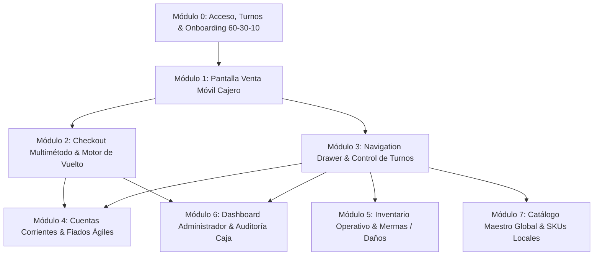

# DESIGN: Sistema de Diseño e Interfaz UI/UX Integral — POS SaaS para Bodegas y Minimarkets

<!-- impeccable:design-schema 2 -->
<!-- Stitch:google-stitch-spec 1.0 -->

## 1. Visión Holística del Producto y Principios Rectores

El **Punto de Venta (POS) SaaS** para micro-retail barrial (bodegas, minimarkets, tiendas de conveniencia) está concebido bajo una premisa innegociable: **cero fricción tecnológica, usabilidad táctil extrema y $0 de inversión en hardware dedicado**.

Para lograr una adopción masiva en comerciantes con nula o escasa alfabetización digital, el diseño de la interfaz sustituye el cuaderno manual, la calculadora física y los engorrosos ERPs contables por una experiencia fluida, rápida (< 3 segundos por transacción) y visualmente intuitiva.

### 1.1 Principios Rectores de Interfaz (Craft Floor)
1. **Regla de Color 60-30-10 Estricta y Dinámica:**
   - **60% Dominante:** Fondos neutros limpios (`zinc-50` / `#F4F4F5`, `white` / `#FFFFFF`), superficies pulidas y tipografía nítida (`zinc-900` / `#18181B`).
   - **30% Secundario:** Tarjetas de producto, contenedores de navegación, segmented controls y paneles laterales (`zinc-100` / `zinc-200`).
   - **10% Acento:** Color de llamada a la acción primario, alertas de escaneo exitoso y badges de notificación activa. Por defecto **Verde Esmeralda** (`emerald-600` / `#059669` / `#10B981`) personalizable mediante extracción K-Means de logo.
2. **Ergonomía Single-Thumb (Una Sola Mano):**
   - Todos los controles críticos (botón `COBRAR`, conmutador Escáner/Teclado, numpad, billetes rápidos) se ubican en el arco inferior de alcance del pulgar en smartphones (390px a 430px de ancho).
   - Altura mínima táctil para botones principales: **52px**.
   - Altura mínima táctil para teclas del teclado numérico: **56px**.
   - Padding táctil generoso (mínimo 48px en filas de navegación).
3. **Feedback Multisensorial Acelerado:**
   - **Visual:** Retícula de cámara con guías de esquina, iluminación pulsante de láser y cambio inmediato de estado.
   - **Sonoro:** Beep sintetizado ultra-ligero mediante `Web Audio API` (sin latencia de descarga de MP3).
   - **Háptico:** Vibración confirmatoria (`navigator.vibrate([60])`) al identificar un código o agregar ítem.
4. **Resiliencia Offline-First Observable:**
   - Indicador de conectividad siempre presente en cabecera. La transición entre conexión Cloud y base de datos local `IndexedDB` (Dexie.js) es imperceptible para el cajero y no bloquea transacciones.

---

## 2. Sistema de Tokens de Diseño (Design Tokens)

Este sistema de tokens está estructurado para integrarse nativamente con **Google Stitch**, **Tailwind CSS v3/v4**, **Figma Tokens Studio** y bibliotecas de componentes basadas en **Shadcn UI**.

### 2.1 Paleta Cromática (Color Palette)

| Token Name | Hex Code | Tailwind Class | Rol / Aplicación |
| :--- | :--- | :--- | :--- |
| `surface-bg` | `#F4F4F5` | `bg-zinc-100` / `bg-zinc-50` | Fondo dominante de la aplicación (60%) |
| `surface-card` | `#FFFFFF` | `bg-white` | Tarjetas de contenido, display numpad, modal |
| `surface-subtle` | `#E4E4E7` | `bg-zinc-200` | Segmented controls, chips inactivos, divisores |
| `surface-border` | `#E4E4E7` / `#D4D4D8` | `border-zinc-200` | Bordes sutiles y delimitadores limpios |
| `text-primary` | `#18181B` | `text-zinc-900` | Títulos, importes monetarios principales |
| `text-secondary` | `#71717A` | `text-zinc-500` | Subtítulos, horas de turno, etiquetas |
| `text-muted` | `#A1A1AA` | `text-zinc-400` | Placeholders, separadores secundarios |
| `accent-primary` | `#10B981` | `bg-emerald-500` | Acento (10%): Botón `COBRAR`, esquinas visor |
| `accent-hover` | `#059669` | `bg-emerald-600` | Estado hover/active del botón de cobro |
| `accent-glow` | `rgba(16,185,129,0.3)` | `shadow-emerald-500/30` | Resplandor de elevación del botón principal |
| `badge-fiado` | `#F59E0B` | `bg-amber-500` / `text-amber-700` | Módulo de cuentas corrientes / fiados |
| `badge-yape` | `#7C3AED` | `bg-purple-600` | Identidad billeteras digitales QR (Yape) |
| `badge-plin` | `#0284C7` | `bg-sky-600` | Identidad billeteras digitales QR (Plin) |
| `badge-other` | `#52525B` | `bg-zinc-600` | Método de pago residual "Otro" (entidad neutra) |
| `badge-card` | `#2563EB` | `bg-blue-600` | Identidad del método de pago Tarjeta (pintado azul de Tarjeta :417; delta D6 — SDD stitch-admin-prompts) |
| `danger-action` | `#E11D48` | `bg-rose-600` / `text-rose-500` | Botón borrar numpad, mermas, vaciar carro |

### 2.2 Tipografía y Escalas (Typography)
- **Tipografía Principal:** `Inter`, `-apple-system`, `BlinkMacSystemFont`, `Segoe UI`, `sans-serif`.
- **Tipografía Numérica / Tabular:** `JetBrains Mono`, `ui-monospace`, `monospace` con `font-feature-settings: "tnum" 1` (para alineación de dígitos monetarios).

| Escala | Tamaño | Interlineado | Peso | Caso de Uso |
| :--- | :--- | :--- | :--- | :--- |
| `display-xl` | 36px (2.25rem) | 40px | 900 (Black) | Pantalla gigante de vuelto (`VUELTO S/ 23.50`) |
| `display-lg` | 30px (1.875rem) | 36px | 800 (ExtraBold)| Display numpad de monto manual (`S/ 12.00`) |
| `heading-md` | 20px (1.25rem) | 28px | 700 (Bold) | Total en botón sticky COBRAR, títulos modales |
| `body-md` | 14px (0.875rem) | 20px | 600 (SemiBold) | Botones de acción, nombres de productos |
| `body-sm` | 12px (0.75rem) | 16px | 500 (Medium) | Info de turno, badges de conectividad |
| `caption-xs` | 10px (0.625rem) | 12px | 700 (Bold) | Etiquetas en mayúsculas (MONTO MANUAL, TOTAL) |

### 2.3 Elevaciones, Bordes y Radios (Elevation & Radii)
- **Radios:**
  - `rounded-xl` (12px): Botones secundarios, teclas del teclado, tarjetas de granel.
  - `rounded-2xl` (16px): Viewport de cámara, tarjetas de display, modal de cobro.
  - `rounded-3xl` (24px): Hojas desplegables inferiores (Sheets), bottom drawers.
- **Sombras:**
  - `shadow-xs`: `0 1px 2px 0 rgba(0, 0, 0, 0.05)`.
  - `shadow-keypad`: `0 2px 4px rgba(0, 0, 0, 0.04), 0 1px 2px rgba(0, 0, 0, 0.06)`.
  - `shadow-emerald-glow`: `0 8px 24px -4px rgba(16, 185, 129, 0.35)`.

---

## 3. Arquitectura Modular del Sistema (Los 8 Módulos Core)



---

## 4. Especificación Detallada de Módulos (Google Stitch Specs)

### MÓDULO 0: Acceso, Turnos y Onboarding de Negocio Dinámico

#### 0.1 Selector de Acceso Rápido
- **Pantalla:** Entrada unificada con login dual (Empleado vs. Administrador).
- **Acceso Empleado (Cajero) — scope MVP:**
  - Desbloqueo por PIN de 4 dígitos ligado al dispositivo (sesión `tenant_id + user_id` en JWT del dispositivo); sin correo ni contraseñas largas en mostrador y sin depender de red (validez offline 7+ días según contrato de arquitectura).
  - Selector de cajero por foto/nombre y selector de turno (Mañana 8am-4pm / Tarde 4pm-11pm): **post-MVP** — el alcance congelado es 1 dispositivo, 1 cajero.
- **Acceso Administrador:** Correo/Teléfono y contraseña maestra, con acceso a métricas globales.

#### 0.2 Onboarding y Extractor de Marca K-Means (Admin Setup)
- **Carga de Identidad:** Input para nombre de la bodega y subida de logotipo.
- **K-Means Color Extractor:**
  - Algoritmo que analiza el logotipo subido y extrae la paleta 60-30-10:
    - 60%: Fondo claro o neutro adaptado.
    - 30%: Barras de navegación y tarjetas en degradado suave.
    - 10%: Botón `COBRAR` y acentos de éxito (por defecto verde esmeralda si el logo es monocromo).
- **Interruptores de Características (Feature Toggles):**
  - `¿Maneja fiados?` (Si es NO, oculta completamente el método de fiado en caja).
  - `¿Emite comprobantes fiscales?` (Activa captura opcional de DNI/RUC para boleta/factura).
  - `¿Tiene lectores de barra USB/Bluetooth?` (Fija Escáner o Teclado como vista por defecto; en MVP sin lector, la vista por defecto es la **grilla de Productos**).

---

### MÓDULO 1: Pantalla de Venta Móvil de Alta Velocidad (Cajero Core)

#### 1.1 Cabecera Persistente (Status & Shift Header)
- **Avatar de Usuario:** Círculo con borde en degradado de acento, iniciales o foto del cajero.
- **Información de Turno:** Nombre del cajero (`María Gómez`) y horario (`Turno 8:00 am - 4:00 pm`).
- **Badge de Conectividad en Tiempo Real:**
  - *Verde (`En línea`):* Sincronización continua con backend.
  - *Ámbar (`Modo Offline - IndexedDB`):* Al desconectarse, conmuta automáticamente a almacenamiento local sin interrumpir ventas ni alertar con ventanas bloqueantes.
- **Accesos Rápidos:** Engranaje de caja rápida (fondo inicial de caja) y botón hamburguesa del Drawer.

#### 1.2 Segmented Control Ergonómico (Productos / Escáner / Teclado)
- Control de 3 segmentos con micro-animación deslizante de fondo blanco elevado. En MVP el segmento **Productos (grilla) es la vista por defecto**: la arquitectura fija la grilla de favoritos como happy path y la cámara como best-effort (si el p95 del escaneo supera 3s, la grilla sigue siendo el default). El toggle de onboarding puede fijar Escáner o Teclado por defecto cuando hay lector USB/Bluetooth.
- **Segmento por defecto — Grilla de Productos (happy path):**
  - Grid táctil de favoritos y granel (pan, huevos, hielo) con tiles de mínimo 48px de altura: foto, nombre y precio. Agregar con UN solo toque (feedback háptico `navigator.vibrate([60])`).
  - Búsqueda rápida por nombre y filtro por categoría; al agregar, el tile muestra micro-badge de cantidad (`×2`) y la barra inferior se actualiza al instante.
- **Segmento Escáner (best-effort, no bloqueante):**
  - Viewport de cámara en proporción 4:3 con esquinas guía de enfoque en verde esmeralda (`border-emerald-500`).
  - Línea láser animada de barrido; botón flotante de flash / linterna (`Torch API`) y botón manual de disparo con feedback háptico. Al decodificar: esquinas pasan de zinc a esmeralda + flash de éxito + beep + vibración.
  - Si la cámara falla o se deniega el permiso: fallback NO bloqueante a la grilla de Productos con aviso no modal (ver Estados y Motion Spec).
  - Carrusel inferior de **Favoritos & Granel** accesible también desde aquí.
- **Segmento Teclado Numérico Ergonómico (Numpad 56px):**
  - Display digital superior con formato de moneda en Soles (`S/ 0.00`) y etiqueta `MONTO MANUAL`.
  - Matriz 3x4 con teclas de 56px de altura: filas `1-2-3`, `4-5-6`, `7-8-9`, y fila inferior `00 - 0 - Borrar`.
  - Botón secundario `+ Agregar al Ticket` con elevación neutra.

#### 1.3 Barra Inferior Persistente (Sticky Bottom Bar)
- Fijada en el fondo de la pantalla con altura ergonómica.
- Fila superior: Cantidad de ítems en carrito (`Tickets (X productos)`), subtotal acumulado y botón `Vaciar`.
- **Botón Primario `COBRAR`:**
  - Altura táctil: **52px**.
  - Color: **Verde Esmeralda** (`#10B981` / `emerald-600`) con tipografía Bold de alto contraste en blanco.
  - Despliegue del total a cobrar en tipografía monoespaciada a la derecha.

---

### MÓDULO 2: Checkout Multimétodo y Motor de Cálculo de Vuelto

#### 2.1 Selector de Métodos de Pago (Tender Único)
Cuadrícula de 6 tarjetas táctiles de selección inmediata, alineada con la restricción CHECK de `DATABASE.md` (`cash, yape, plin, card, other, fiado`). **Tender único por venta** en MVP (sin split tender): elegir un método define el valor exacto de `sales.payment_method`.
1. **Efectivo:** Activa la calculadora de vuelto y los chips de billetes rápidos.
2. **Yape:** Identidad billetera Yape (púrpura `#7C3AED`); muestra QR dinámico en pantalla o confirmación de recepción rápida con código de operación.
3. **Plin:** Identidad billetera Plin (celeste `#0284C7`); mismo flujo de recepción que Yape.
4. **Tarjeta:** Opciones para cobro con POS inalámbrico o terminal POS externo.
5. **Otro:** Método residual (vale, divisa extranjera, pago mixto manual) — token neutro zinc.
6. **Fiado (Cuentas Corrientes):** Abre el buscador de cliente deudor registrado; oculto por feature toggle si el negocio no maneja fiados.

#### 2.2 Billetes Rápidos y Pantalla Gigante de Vuelto
- **Chips de Billetes Rápidos:** Botones de un toque para denominaciones comunes (`S/ 10`, `S/ 20`, `S/ 50`, `S/ 100`, y botón `Exacto`).
- **Pantalla Gigante de Vuelto:**
  - Tarjeta en verde esmeralda suave (`bg-emerald-50`, borde `border-emerald-500`).
  - Número gigante en `JetBrains Mono` a 36px (`VUELTO: S/ 23.50`).
- **Acciones Finales:**
  - Botón principal de ancho completo `FINALIZAR VENTA`.
  - Estado de éxito tras finalizar: ticket en pantalla (resumen + número de operación) con animación de check, beep y vibración; acción secundaria `Compartir` que abre el **share sheet nativo** del sistema. El envío por WhatsApp (`wa.me`) queda **fuera del alcance MVP** (sin camino WABA/wa.me según `SPRINTS.md`); puede habilitarse post-MVP detrás de feature toggle.

---

### MÓDULO 3: Navigation Drawer y Gestión Operativa de Turnos

#### 3.1 Drawer Deslizable (Navigation Sheet)
- Panel lateral accesible mediante gesto táctil de arrastre o botón de menú.
- Cabecera con logotipo de la tienda, nombre del local y versión del software.
- Menú con enlaces táctiles de mínimo 48px de altura:
  - 🛍️ *Punto de Venta* (Activo)
  - 💵 *Gestión de Caja y Turnos*
  - 👥 *Cuentas y Fiados*
  - 📦 *Inventario / Stock Rápido*
  - ⚠️ *Mermas y Daños*
  - ⏱️ *Marcaje de Asistencia*
- **Bloque de Administración:** Separado visualmente en la base del Drawer, protegido por PIN maestro.

#### 3.2 Gestión de Caja y Arqueo
- **Apertura de Caja:** Registro de efectivo base inicial.
- **Arqueo Intermedio:** Comprobación rápida de efectivo sin cerrar el turno.
- **Egresos de Emergencia:** Registro de retiros menores (ej. pago urgente a repartidor de pan o compra de cambio).
- **Cierre de Turno:** Cuadre de caja con comparativa automática entre ventas del sistema y dinero físico contado.

---

### MÓDULO 4: Cuentas Corrientes y Fiados Ágiles

- **Registro de Deudor en 2 Clics:** Búsqueda rápida por nombre o número de teléfono.
- **Límites de Crédito:** Indicador visual de advertencia cuando un cliente supera su límite de fiado fijado por el dueño.
- **Historial de Abonos Parciales:** Registro de pagos en efectivo o transferencia amortizando la deuda.
- **Recordatorios por WhatsApp:** Envío de estado de cuenta detallado con un solo toque desde la app. **Post-MVP** (sin camino WABA/wa.me en MVP según `SPRINTS.md` S6-4); en MVP el envío usa el share sheet nativo.

---

### MÓDULO 5: Inventario Operativo y Registro de Mermas / Daños

- **Consulta Rápida de Stock:** Búsqueda por código de barras o nombre con indicador visual de semáforo (Verde: Stock normal / Amarillo: Stock bajo / Rojo: Quiebre).
- **Módulo de Mermas / Daños:**
  - Botón directo para reportar mercadería rota, vencida o en mal estado.
  - Captura opcional de foto de evidencia con la cámara.
  - Motivo de la merma (Vencimiento, Rotura en transporte, Daño en vitrina).
  - Descuento automático de stock sin generar movimiento de venta.

---

### MÓDULO 6: Dashboard de Administrador y Auditoría

- **Métricas Clave (KPIs):**
  - Total vendido en el día (`S/ Ventas Netas`).
  - Ticket promedio y volumen de transacciones.
  - Desglose por método de pago: % Efectivo vs. % Billeteras Digitales (Yape/Plin).
  - Deuda acumulada en fiados por cobrar.
- **Auditoría de Turnos:**
  - Listado de turnos con diferencias de caja (sobrante / faltante).
  - Registro de asistencia de empleados con hora exacta de entrada, almuerzo y salida.
- **Gráfico de Horas Pico:** Distribución horaria de ventas para optimizar personal en mostrador.

---

### MÓDULO 7: Catálogo Maestro Global y SKUs Locales

- **Catálogo Maestro Colaborativo (Crowdsourced):**
  - Al escanear un producto nuevo, el sistema consulta la base global compartida.
  - Si existe, autocompleta instantáneamente: Nombre comercial, Marca, Foto oficial y Categoría.
  - El bodeguero solo ingresa su **Precio de Venta** y **Stock Inicial**.
- **Gestión de Precios y Márgenes:**
  - Cálculo de margen comercial entre costo mayorista y precio al público.
  - Alertas automáticas de actualización de precios ante inflación o alzas de proveedores.

---

## 5. Estados y Motion Spec (Feedback & States)

### 5.1 Estados Requeridos (obligatorios para Stitch)
- **Cámara — permiso denegado:** Tarjeta no-modal con icono y texto "Permiso de cámara denegado"; botón `Abrir ajustes` y fallback directo a la grilla de Productos.
- **Cámara — no disponible / falla:** Fallback NO bloqueante a la grilla de Productos con aviso no modal; la venta nunca queda bloqueada por el escáner.
- **Código no encontrado:** Frame rojo breve (300ms) + beep grave + vibración `[30,60,30]`; la grilla/búsqueda sigue activa.
- **Carrito vacío:** Botón `COBRAR` deshabilitado (opacidad 40%, sin glow) hasta que haya ≥1 ítem en el ticket.
- **Offline — sync pendiente:** Badge de cabecera ámbar con contador `X ventas por sincronizar`; al reconectar, badge verde + toast "Sincronizado".
- **Conflicto servidor vs dispositivo:** Diálogo de decisión explícito con ambos valores ("Servidor: S/ X — Este dispositivo: S/ Y") y opción de aceptar el servidor por defecto; **el servidor manda** (`server wins`).
- **Éxito de venta:** Pantalla de ticket con animación de check (scale-in + fade), beep de éxito y vibración `[60, 60]`.

### 5.2 Motion Spec (movimiento inclusivo)
- **Pulsación de tecla/botón:** `scale 0.97` + sombra reducida, 100ms ease-out.
- **Escaneo exitoso:** guías de esquina zinc → esmeralda + flash de la línea láser, 250ms.
- **Cambio de segmento:** deslizamiento del indicador blanco, 200ms ease-in-out.
- **Cálculo de vuelto:** count-up numérico en `JetBrains Mono` desde `S/ 0.00`, 450ms, con decimales estables.
- **Drawer / Sheet:** spring suave (salida 300ms).
- **Reduced motion:** todo lo anterior respeta `prefers-reduced-motion` (fades ≤150ms, sin escala ni láser).
- **Sonido / Háptica:** beeps por `Web Audio API` (oscillator corto, sin MP3); vibración `[60]` al agregar ítem o escanear, patrón de error `[30,60,30]`.
- **Sin animaciones gratuitas:** nada se anima si no comunica estado — sin confeti, sin saltos decorativos.

---

## 6. Adaptación Web / Desktop (responsive): Arquitectura Multi-panel y Ergonomía de Teclado

Siguiendo las directivas de **Impeccable** (`adapt.md`) y la filosofía de **Emil Kowalski**:
> *"La adaptación no consiste en escalar píxeles, sino en repensar la experiencia para el nuevo contexto. En desktop, el espacio horizontal permite eliminar disclosure progresivo innecesario, exponer paneles concurrentes y acelerar la operación mediante atajos de teclado sin animaciones parásitas."*

### 6.1 Disposición Espacial Multi-Panel (Three-Column Layout)
En pantallas de escritorio o computadoras All-in-One de mostrador (`1280px` a `1440px+`), la interfaz pasa de navegación secuencial por pantallas a una distribución de tres columnas persistentes y concurrentes:

```
┌─────────────────┬──────────────────────────────────────────┬─────────────────────────────┐
│ 1. SIDEBAR      │ 2. ZONA DE CATÁLOGO & BÚSQUEDA RÁPIDA    │ 3. PANEL DE ORDEN / TICKET  │
│    (240px Fijo) │    (Flex-1 Central, Scroll Independiente)│    (380px–420px Persistente)│
│                 │                                          │                             │
│ • Local & Turno │ • Barra de Búsqueda Global (F2)          │ • Cabecera Ticket #2041     │
│ • Menú Módulos: │ • Categorías / Filtros Rápidos           │ • Líneas del Carrito:       │
│   - POS Mostrador│ • Grilla de Productos (Cards densas)     │   - Cantidad editable (F3)  │
│   - Caja / Arqueo│ • Pestaña Escáner / Visor WebUSB/WebCam  │   - Precio y Subtotal unit. │
│   - Fiados      │ • Teclado Numérico Flotante / Acceso     │ • Desglose:                 │
│   - Inventario  │                                          │   - Subtotal S/             │
│   - Mermas      │                                          │   - Descuentos              │
│   - Reportes    │                                          │   - Total S/ en JetBrains   │
│ • Conexión Sync │                                          │ • Selector Tender Rápido    │
│ • Admin (PIN)   │                                          │ • Botón Gigante COBRAR (F4) │
└─────────────────┴──────────────────────────────────────────┴─────────────────────────────┘
```

### 6.2 Ergonomía e Interacciones según Emil Kowalski (Desktop Craft)
1. **Regla de Cero Animación en Acciones Frecuentes:**
   - La escritura en la barra de búsqueda y el agregado de productos mediante ráfaga de escáner HID (< 40ms) o teclado **NO tienen animaciones de entrada ni retrasos**. Se ejecutan en 0ms.
   - El refresco de totales del ticket no produce saltos de layout (*Layout Shift = 0*).
2. **Micro-interacciones Táctiles y de Puntero:**
   - Botones y tarjetas de producto usan `:active { transform: scale(0.98); }` con `transition: transform 120ms ease-out` (nunca `transition: all`).
   - Hover states sutiles (`bg-zinc-50` / `border-zinc-300`) con `border` fijo para evitar parpadeos de tamaño.
   - Diálogos y modales de cobro abren con `scale(0.95) -> scale(1)` y `opacity: 0 -> 1` con curva `cubic-bezier(0.16, 1, 0.3, 1)` (resorte amortiguado sin rebote molesto).
3. **Mapeo de Atajos de Teclado Físico (Keyboard-First):**
   - `F2` o `/`: Enfocar buscador de productos.
   - `F3`: Modificar cantidad de la última línea agregada.
   - `F4` o `Enter` (con carro no vacío): Abrir modal de cobro / Checkout.
   - `1` a `6` en Checkout: Selección directa del Tender (`1` Efectivo, `2` Yape, `3` Plin, `4` Tarjeta, `5` Otro, `6` Fiado).
   - `Esc`: Cancelar / Cerrar modales o limpiar búsqueda.
   - `Supr`: Eliminar producto seleccionado del ticket.

### 6.3 Breakpoints Responsive y Comportamiento de Colapso (Web)

La versión web **no es mobile escalado ni desktop fijo**: es un layout fluido con un único punto de quiebre estructural. El sistema de diseño 60-30-10 y los tokens (Inter, JetBrains Mono, zinc + esmeralda, radios 12/16/24) son idénticos en todos los anchos; solo cambia la disposición de paneles.

| Breakpoint | Ancho | Disposición | Comportamiento de los 3 paneles |
| :--- | :--- | :--- | :--- |
| Desktop XL | ≥ 1280px | **3 columnas** (la §6.1) | Sidebar 240px fija + Catálogo flex-1 + Ticket 380–420px persistente. Es el caso de mostrador All-in-One. |
| Laptop / Tablet horizontal | 1024–1279px | **3 columnas adaptadas** | Sidebar colapsa a iconos (64px) o se oculta tras hamburguesa; Catálogo gana espacio; Ticket baja a 340–360px. Los atajos F2–F4 siguen activos. |
| Tablet vertical | 768–1023px | **2 paneles + ticket flotante** | Sidebar se convierte en **drawer** (gesto/hamburguesa, mismo componente del Módulo 3); Catálogo full-width; el **Ticket se vuelve sheet/bottom-drawer** accesible desde el botón `COBRAR` (F4) o un botón flotante de carrito. |
| Mobile | < 768px | **1 columna** | Cae a la especificación móvil original (§§1–5, viewport 390px): sticky bottom bar, segmented Products/Escáner/Teclado, single-thumb. |

Reglas de colapso obligatorias:
1. **Ningún panel se estira arbitrariamente:** el Ticket tiene ancho máximo de 420px en desktop y nunca se expande a full-width salvo en tablet vertical (sheet) o mobile (sticky bottom bar).
2. **Grilla de productos fluida:** mín. 2 columnas en mobile, 3–4 en tablet, 4–6 en desktop (tarjetas densas con hover); nunca una columna única en web.
3. **Sidebar→drawer threshold:** en `1023px` y por debajo la sidebar persistente desaparece y su contenido vive en el drawer del Módulo 3, con los mismos enlaces y el bloque Admin (PIN) al final.
4. **Atajos de teclado:** activos en ≥ 768px (cualquier dispositivo con teclado físico); en mobile siguen disponibles con teclado externo pero nunca son el único camino.
5. **Modales de cobro:** en desktop abren como diálogo centrado (scale 0.95→1, bezier 0.16,1,0.3,1); en < 768px como bottom sheet (radios `rounded-3xl` superiores).

### 6.4 Prompt Stitch 5: Desktop Web App — Counter Cashier Station (1440x900px)
```text
System: Google Stitch UI Engine v1.0
Task: Generate a high-fidelity desktop web application interface for POS counter station.
Device: Desktop landscape viewport 1440x900px. This is the >=1280px branch of a responsive web layout (breakpoints per spec section 6.3); render the 3-column desktop arrangement.
Design System: Shadcn UI clean light neutral, 60-30-10 color rule.
Background (60%): Clean off-white surface-100 (#F4F4F5), pure white cards (#FFFFFF), crisp border-zinc-200.
Secondary (30%): Zinc-100 components, subtle navigation sidebar and categories.
Accent (10%): Vibrant Emerald Green (#10B981) for primary checkout CTA.
Layout Architecture: 3 columns (Sidebar 240px + Catalog Flex-1 + Order Summary 380px) — do NOT render mobile bottom bars or segmented controls in this variant.
1. Left Sidebar (240px): Store brand 'Bodega San Pedro', cashier profile 'María Gómez', shift '8:00 AM - 4:00 PM', online green badge, navigation links with clean Lucide icons (POS Mostrador [active], Caja, Fiados, Inventario, Reportes), bottom admin button with PIN badge.
2. Center Catalog Workspace (Flex-1):
   - Top Bar: Search input with shortcut hint '[F2] Buscar producto o escanear código...', barcode scan status pill.
   - Category Pills: 'Todos', 'Abarrotes', 'Lácteos', 'Bebidas', 'Limpieza', 'Granel / Panadería'.
   - Product Grid: 4-column responsive grid of dense product cards with crisp images/thumbnails, name, unit price in bold JetBrains Mono 'S/ 4.80', and stock indicator.
3. Right Sticky Order Summary Panel (380px):
   - Order Header: 'Ticket #2041' with time and item count.
   - Line Items Table: Scrollable list of cart items with quantity steppers (- / +), item name, unit price, and subtotal.
   - Summary Box: Subtotal, IGV/Tax, and giant Total display 'TOTAL: S/ 42.50' in JetBrains Mono.
   - Quick Tender Buttons: Grid of 6 tenders ('Efectivo', 'Yape', 'Plin', 'Tarjeta', 'Otro', 'Fiado').
   - Bottom Primary Button: 52px high full-width Emerald Green button 'COBRAR [F4] — S/ 42.50' with subtle glow.
Typography: Inter font with JetBrains Mono for tabular monetary figures (S/).
```

### 6.5 Prompt Stitch 6: Tablet Vertical Responsive Web — Cashier Station (768x1024px)
```text
System: Google Stitch UI Engine v1.0
Task: Generate the tablet-vertical breakpoint (768x1024px) of the responsive POS web app.
Device: Tablet portrait viewport 768x1024px. This is the 768-1023px branch of the responsive layout (spec section 6.3): sidebar has collapsed into a drawer, catalog is full-width, and the order ticket lives as a bottom sheet behind the COBRAR button.
Design System: Shadcn UI clean light neutral, 60-30-10 color rule.
Background (60%): Clean off-white/zinc-50 (#F4F4F5), pure white cards (#FFFFFF), crisp border-zinc-200.
Secondary (30%): Zinc-100 components.
Accent (10%): Vibrant Emerald Green (#10B981) for primary checkout CTA.
Layout Architecture: 2 panels visible (top app bar + catalog); drawer and ticket are overlays, not columns. Do NOT render a persistent 3-column desktop layout.
1. Top Bar: Store brand 'Bodega San Pedro', hamburger menu button (drawer trigger), cashier 'María Gómez' + shift '8:00 AM - 4:00 PM', online green badge, search icon.
2. Catalog Workspace (full width, one column under the top bar):
   - Search input with shortcut hint '[F2] Buscar producto o escanear código...', barcode scan status pill.
   - Category Pills (horizontal scroll): 'Todos', 'Abarrotes', 'Lácteos', 'Bebidas', 'Limpieza', 'Granel / Panadería'.
   - Product Grid: 3-column dense cards with thumbnail, name, unit price in bold JetBrains Mono 'S/ 4.80', stock indicator.
3. Overlay Drawer (open state, right edge or left edge): navigation links (POS Mostrador [active], Caja, Fiados, Inventario, Reportes), bottom admin button with PIN badge.
4. Floating Cart / COBRAR button (bottom-right): shows ticket item count '3' badge and label 'COBRAR [F4] — S/ 42.50' in Emerald Green; tapping opens the ticket bottom sheet (do not render the sheet content in this frame unless space allows; show a hint).
Typography: Inter font with JetBrains Mono for tabular monetary figures (S/).
```

---

## 7. Prompts Estructurados de Generación para Google Stitch

Los siguientes prompts están optimizados para ser procesados directamente por la herramienta de generación visual **Google Stitch**:

### Prompt Stitch 1: Cashier View (Products Grid Happy Path & Tabs)
```text
System: Google Stitch UI Engine v1.0
Task: Generate a high-fidelity mobile Point of Sale (POS) Cashier View interface.
Device: Smartphone viewport 390x844px.
Design System: Shadcn UI minimalist light aesthetic, 60-30-10 color rule.
Background (60%): Clean off-white/zinc-50 (#F4F4F5), pure white surface cards (#FFFFFF), crisp border-zinc-200.
Secondary (30%): Zinc-100 components, soft grey segmented control tabs.
Accent (10%): Vibrant Emerald Green (#10B981) for primary CTA buttons.
Components to render:
1. Header: Circular avatar with cashier initials 'MG', employee name 'María Gómez', shift 'Turno 8:00 am - 4:00 pm', green status badge 'En línea', wifi and settings icons.
2. Segmented Control: 3 tabs ('Productos' [active/happy-path], 'Escáner' [best-effort], 'Teclado').
3. Products Grid Viewport: 2-column grid of favorite/quick-add cards (large photo/icon, bold product name, price in soles S/ 0.00, hit targets ≥ 48px), plus quick-add favorite chips for bakery and bulk items below.
4. Sticky Bottom Bar: White persistent card displaying 'Tickets (3 productos) - S/ 14.50' and a 52px full-width emerald green primary button 'COBRAR (S/ 14.50)' with thumb-friendly ergonomics.
Typography: Inter font with JetBrains Mono for monetary digits in Peruvian Soles (S/).
```

### Prompt Stitch 2: Cashier Numpad Ergonomic Keypad
```text
System: Google Stitch UI Engine v1.0
Task: Generate a mobile POS manual amount entry screen with 56px ergonomic numpad.
Device: Smartphone viewport 390x844px.
Style: Clean modern minimalist, light neutral palette, soft elevation shadows.
Components:
1. Display Card: Elevated white card displaying 'MONTO MANUAL' in uppercase zinc-400 and giant tabular amount 'S/ 12.00' in bold zinc-900.
2. Keypad: 3x4 grid of 56px rounded buttons (rows 1-2-3, 4-5-6, 7-8-9, and 00-0-delete with rose red icon). Clean tactile depth with soft shadow and crisp border.
3. Secondary Action: '+ Agregar al Ticket' full-width dark zinc button.
4. Sticky Bottom Bar: Synced cart summary and full-width emerald green button 'COBRAR'.
```

### Prompt Stitch 3: Checkout Modal & Instant Change Return
```text
System: Google Stitch UI Engine v1.0
Task: Generate an interactive checkout and change calculation modal for mobile POS.
Device: Smartphone viewport 390x844px with bottom sheet overlay.
Components:
1. Header: Total to pay display 'TOTAL A COBRAR: S/ 26.50'.
2. Payment Tenders: 6 tappable cards (single tender per sale) — 'Efectivo' (active green), 'Yape' (purple), 'Plin' (sky blue), 'Tarjeta' (blue icon), 'Otro' (neutral zinc), 'Fiado' (amber).
3. Fast Cash Chips: Quick denomination buttons for 'S/ 10', 'S/ 20', 'S/ 50', and 'Exacto'.
4. Received Display: Amount received input card showing 'Recibido: S/ 50.00'.
5. Prominent Change Box: Soft emerald green highlighted box displaying 'VUELTO: S/ 23.50' in 36px bold JetBrains Mono.
6. Actions: Emerald primary button 'FINALIZAR VENTA'; on success show on-screen ticket with native 'Compartir' share-sheet secondary action (no WhatsApp/wa.me call in MVP).
```

### Prompt Stitch 4: Operational Drawer & Admin Dashboard
```text
System: Google Stitch UI Engine v1.0
Task: Generate a dual-view presentation of the POS Navigation Drawer and Admin KPI Dashboard.
Style: Clean, modular, responsive 60-30-10 palette with Shadcn UI cards.
Drawer: Store brand 'Bodega San Pedro', daily operational links (POS, Cash Drawer, Credit Ledger, Inventory, Waste Log, Attendance), with protected 'Admin Panel (PIN)' at the bottom.
Dashboard: Top KPI cards (Net Daily Sales in Soles S/, Transaction count, Digital vs Cash split percentage, Outstanding Fiado credit), recent shift closures table with cash discrepancies, and hourly volume bar chart.
```

---

### 7.1 Admin Prompt Suite — rol Administrador (desktop 1440x900)

> **SUPERSEDED — frame antiguo:** el `Prompt Stitch 4: Operational Drawer & Admin Dashboard` (:424-431) es un frame dual-view superficial (sin viewport, sin tokens, sin tipografía) y queda **reemplazado por esta suite**. El texto antiguo se conserva en su lugar hasta que la suite esté completa; a partir del primer prompt emitido, esta suite es la fuente única de prompts para las pantallas del rol **Administrador**.

Suite de **8 prompts por pantalla** (no un mega-prompt) que implementa primero la interfaz del rol **Administrador** en desktop `1440x900px`. Cada prompt es **autocontenido** — Google Stitch no puede cruzar referencias entre prompts ni leer `DESIGN.md` —, por lo que cada uno inline (a) el contrato de tokens verbatim de §2.1 (Block T), (b) su contrato de layout, (c) su mapa de teclado, (d) sus estados declarados, (e) su sample data, y (f) un **footer anti-drift** con refs de línea exactas. Ningún prompt dice "como se muestra en el prompt N" ni "ver DESIGN.md". La consistencia entre prompts se garantiza por Block T + diff del footer en revisión.

- P1 Login-1: selector de rol (Empleado / Administrador)
- P2 Login-2: credencial (variante Admin primaria; variante Empleado PIN especificada)
- P3 Shell + acceso Admin
- P4 Dashboard / auditoría
- P5 Cierre de caja y arqueo
- P6 Fiados
- P7 Inventario y mermas
- P8 Catálogo maestro y márgenes

#### Prompt Admin 1 — Login-1: selector de rol (P1)

```text
System: Google Stitch UI Engine v1.0
Task: Generate a high-fidelity desktop web application interface for the POS admin login — screen 1 of 2: the role selector (Empleado / Administrador). No tenant data and no credential fields on this screen.

Device: Desktop landscape viewport 1440x900px. This is the >=1280px branch of a responsive web layout (breakpoints per DESIGN.md §6.3 :316-318); do NOT render mobile bottom bars or segmented controls in this variant (:339).

[1. Token contract — Block T verbatim (DESIGN.md §2.1 :37-53 + typography :55-66 + elevation :68-76 + badge-card D6)]
Palette:
| Token | Hex | Tailwind | Role |
|---|---|---|---|
| surface-bg | #F4F4F5 | bg-zinc-100 / bg-zinc-50 | 60% app background |
| surface-card | #FFFFFF | bg-white | cards, displays, modal |
| surface-subtle | #E4E4E7 | bg-zinc-200 | segmented controls, chips, dividers |
| surface-border | #E4E4E7 / #D4D4D8 | border-zinc-200 | subtle borders |
| text-primary | #18181B | text-zinc-900 | titles, main amounts |
| text-secondary | #71717A | text-zinc-500 | subtitles, labels |
| text-muted | #A1A1AA | text-zinc-400 | placeholders, separators |
| accent-primary | #10B981 | bg-emerald-500 | 10% accent (primary CTA) |
| accent-hover | #059669 | bg-emerald-600 | hover/active of primary |
| accent-glow | rgba(16,185,129,0.3) | shadow-emerald-500/30 | primary glow — /30 NEVER /20 |
| badge-fiado | #F59E0B | bg-amber-500 / text-amber-700 | fiados module — single hex only |
| badge-yape | #7C3AED | bg-purple-600 | Yape identity |
| badge-plin | #0284C7 | bg-sky-600 | Plin identity |
| badge-other | #52525B | bg-zinc-600 | residual tender "Otro" |
| badge-card | #2563EB | bg-blue-600 | Tarjeta identity (D6 — keeps the blue Tarjeta paint :417 alive) |
| danger-action | #E11D48 | bg-rose-600 / text-rose-500 | delete/numpad, mermas, empty-cart |
Typography: Inter, -apple-system, BlinkMacSystemFont, Segoe UI, sans-serif; numeric/tabular = JetBrains Mono, ui-monospace, monospace with font-feature-settings "tnum" 1 (Layout Shift = 0).
| Scale | Size | LH | Weight | Use |
|---|---|---|---|---|
| display-xl | 36px | 40px | 900 | giant change display (not used in admin) |
| display-lg | 30px | 36px | 800 | numpad display (Login-2 PIN display area) |
| heading-md | 20px | 28px | 700 | totals, modal titles |
| body-md | 14px | 20px | 600 | buttons, product names |
| body-sm | 12px | 16px | 500 | badges, connectivity, table cells |
| caption-xs | 10px | 12px | 700 | uppercase labels (INGRESAR hints, section labels) |
Elevation & radii: rounded-xl 12px (secondary buttons, keys); rounded-2xl 16px (cards, displays, modal); rounded-3xl 24px (bottom sheets — not used on admin desktop); shadow-xs 0 1px 2px rgba(0,0,0,0.05); shadow-keypad 0 2px 4px rgba(0,0,0,0.04), 0 1px 2px rgba(0,0,0,0.06); shadow-emerald-glow 0 8px 24px -4px rgba(16,185,129,0.35).
Design system: Shadcn UI clean light neutral, 60-30-10 (:13-16, :335). Connectivity badge: online = emerald (accent-primary family) 'En línea'; offline = amber badge-fiado 'Modo Offline - IndexedDB' (:127-129); pending-sync counter text 'X ventas por sincronizar' (:254).

[2. Layout contract]
Full-viewport 60% surface (surface-bg #F4F4F5). Centered auth card: surface-card #FFFFFF, rounded-2xl 16px (:71), shadow-xs (:74), max-width ~520px (login contract :101-106). Product wordmark 'POS SaaS' ONLY (doc titles DESIGN.md:1, FRONTEND.md:1) — NO tenant data pre-auth (pos_app holds no SELECT on tenants, DATABASE.md:184, F14). Two role cards side by side, min-height 160px: 'Empleado' (subline 'PIN de 4 dígitos, sin depender de red', :104; Lucide user icon) and 'Administrador' (subline 'Teléfono + contraseña maestra, acceso a métricas', :106; Lucide shield icon). Selected role = accent-primary ring; hover bg-zinc-50/border-zinc-300 fixed border (:302); :active scale(0.98) 120ms ease-out (:301). Caption-xs hint 'Usa ← → para elegir · Enter para continuar' (spec-fixed ADL-1). ConnectivityBadge in card corner (:127-129). No sidebar, no ticket panel (anti-drift R5). Interaction: zero-latency selection (:297-299); no entrance animations (frequent action); prefers-reduced-motion respected (:264).

[3. Keyboard map]
ArrowLeft/ArrowRight move role selection; Enter confirms (spec-fixed ADL-1; keyboard-first FRONTEND.md:23); Esc no-op (nothing open); F3 (:306), F4 (:307), 1-6 tenders (:308), Supr (:310) INACTIVE — station-scoped, declared not applicable to this screen.

[4. Component inventory]
Shadcn primitives: Card, Badge, Button (FRONTEND.md TASK 1.3 :81-83). Lucide icons: user, shield (FRONTEND.md:54). Shared admin: ConnectivityBadge (emerald 'En línea' / amber 'Modo Offline - IndexedDB', DESIGN.md:127-129). Caption-xs hint (DESIGN.md:66). Nothing invented (anti-pill).

[5. States]
Connectivity only (§5.1 :127-129): 'En línea' emerald (primary render); 'Modo Offline - IndexedDB' amber (alternate render, ADL-1.2 — both roles stay selectable offline; Administrador proceeds to Login-2 where submit is gated ADL-2.3). No other §5.1 state renders: camera (:250-251), code-not-found (:252), empty-cart (:253), sync-pending (:254), conflict (:255), sale-success (:256) are station states — declared absent on this screen.

[6. Sample data]
None — wordmark only; no tenant data pre-auth (DATABASE.md:184).

[7. Anti-drift footer]
Refs implemented: DESIGN.md:101-106 (dual login contract), :104 (Empleado PIN subline), :106 (Administrador subline), :127-129 (connectivity badge), :297-299 (zero-latency frequent actions), :301-302 (active/hover), :335 (Shadcn 60-30-10); FRONTEND.md:1 (wordmark), :23 (keyboard-first), :54 (Lucide icons); DATABASE.md:184 (no SELECT on tenants, F14); spec ADL-1, ADL-4; delta D2 (login layout fixed by this spec — no prior visual record, DESIGN.md:101-106 functional only; FRONTEND.md:37-43 no login component). Spec-fixed items (flagged): role-card layout, hint copy 'Usa ← → para elegir · Enter para continuar', keyboard map (ArrowLeft/Right + Enter).
```

#### Prompt Admin 2 — Login-2: credencial (P2)

```text
System: Google Stitch UI Engine v1.0
Task: Generate a high-fidelity desktop web application interface for the POS admin login — screen 2 of 2: the credential screen. PRIMARY render = Administrador variant (phone + master password). SECONDARY render = Empleado variant (4-digit PIN keypad), same screen, second frame.

Device: Desktop landscape viewport 1440x900px. This is the >=1280px branch of a responsive web layout (breakpoints per DESIGN.md §6.3 :316-318); do NOT render mobile bottom bars or segmented controls in this variant (:339).

[1. Token contract — Block T verbatim (DESIGN.md §2.1 :37-53 + typography :55-66 + elevation :68-76 + badge-card D6)]
Palette:
| Token | Hex | Tailwind | Role |
|---|---|---|---|
| surface-bg | #F4F4F5 | bg-zinc-100 / bg-zinc-50 | 60% app background |
| surface-card | #FFFFFF | bg-white | cards, displays, modal |
| surface-subtle | #E4E4E7 | bg-zinc-200 | segmented controls, chips, dividers |
| surface-border | #E4E4E7 / #D4D4D8 | border-zinc-200 | subtle borders |
| text-primary | #18181B | text-zinc-900 | titles, main amounts |
| text-secondary | #71717A | text-zinc-500 | subtitles, labels |
| text-muted | #A1A1AA | text-zinc-400 | placeholders, separators |
| accent-primary | #10B981 | bg-emerald-500 | 10% accent (primary CTA) |
| accent-hover | #059669 | bg-emerald-600 | hover/active of primary |
| accent-glow | rgba(16,185,129,0.3) | shadow-emerald-500/30 | primary glow — /30 NEVER /20 |
| badge-fiado | #F59E0B | bg-amber-500 / text-amber-700 | fiados module — single hex only |
| badge-yape | #7C3AED | bg-purple-600 | Yape identity |
| badge-plin | #0284C7 | bg-sky-600 | Plin identity |
| badge-other | #52525B | bg-zinc-600 | residual tender "Otro" |
| badge-card | #2563EB | bg-blue-600 | Tarjeta identity (D6 — keeps the blue Tarjeta paint :417 alive) |
| danger-action | #E11D48 | bg-rose-600 / text-rose-500 | delete/numpad, mermas, empty-cart |
Typography: Inter, -apple-system, BlinkMacSystemFont, Segoe UI, sans-serif; numeric/tabular = JetBrains Mono, ui-monospace, monospace with font-feature-settings "tnum" 1 (Layout Shift = 0).
| Scale | Size | LH | Weight | Use |
|---|---|---|---|---|
| display-xl | 36px | 40px | 900 | giant change display (not used in admin) |
| display-lg | 30px | 36px | 800 | numpad display (Login-2 PIN display area) |
| heading-md | 20px | 28px | 700 | totals, modal titles |
| body-md | 14px | 20px | 600 | buttons, product names |
| body-sm | 12px | 16px | 500 | badges, connectivity, table cells |
| caption-xs | 10px | 12px | 700 | uppercase labels (INGRESAR hints, section labels) |
Elevation & radii: rounded-xl 12px (secondary buttons, keys); rounded-2xl 16px (cards, displays, modal); rounded-3xl 24px (bottom sheets — not used on admin desktop); shadow-xs 0 1px 2px rgba(0,0,0,0.05); shadow-keypad 0 2px 4px rgba(0,0,0,0.04), 0 1px 2px rgba(0,0,0,0.06); shadow-emerald-glow 0 8px 24px -4px rgba(16,185,129,0.35).
Design system: Shadcn UI clean light neutral, 60-30-10 (:13-16, :335). Connectivity badge: online = emerald (accent-primary family) 'En línea'; offline = amber badge-fiado 'Modo Offline - IndexedDB' (:127-129); pending-sync counter text 'X ventas por sincronizar' (:254).

[2. Layout contract]
Centered auth card ~420px (surface-card, rounded-2xl 16px :71, shadow-xs :74), full-viewport surface-bg. No sidebar, no ticket panel (anti-drift R5). PRIMARY render — Administrador variant: back affordance (icon-button with aria-label 'Volver al selector de rol', Lucide arrow-left; Esc = back to Login-1, ADL-2.4 :309); two labeled fields, each with helper text underneath (spec-fixed): 'Teléfono' (type=tel, inputmode=tel, autocomplete="tel" — pinned to users.phone, DATABASE.md:195, D9; helper 'Usa el teléfono del administrador') and 'Contraseña maestra' (type=password, autocomplete="current-password"; helper 'Contraseña configurada al registrar el negocio'); 52px accent-primary full-width button 'INGRESAR' (uppercase CTA style DESIGN.md:150-174; touch height :151). Submit binds POST /auth/admin-login (IDA-2, ARCHITECTURE.md delta D2). SECONDARY render — Empleado variant (same screen, second frame): 4-digit PIN dot display (caption-xs label 'PIN', spec-fixed adaptation of the numpad monetary display :143; display-lg 30px dots) + ErgonomicNumpad 3x4, 56px keys (:142-145; FRONTEND.md:41), rows 1-2-3 / 4-5-6 / 7-8-9 / 0-Borrar (Borrar key = danger-action :53, shadow-keypad :75). Unlock binds devices.pin_hash + offline_session_valid_until (DATABASE.md:217-218), offline validity 7+ days (DESIGN.md:104), frozen scope 1 device / 1 cashier — NO cashier-by-photo/shift selector (:105). Interaction: zero-latency submit (:297-299); loading submit = no animation (frequent action); prefers-reduced-motion (:264); :active scale(0.98) 120ms ease-out (:301); disabled button = opacity 40%, no glow (disabled-COBRAR pattern :253).

[3. Keyboard map]
Esc = back to Login-1 (:309, ADL-2.4); Enter submits (online only; offline = no-op, button disabled); Tab moves between fields (a11y); Empleado variant: physical digits 0-9 + Backspace + Enter (keyboard-first :304); F2 (:305), F3 (:306), F4 (:307), 1-6 (:308), Supr (:310) INACTIVE — station-scoped, declared not applicable.

[4. Component inventory]
Shadcn primitives: Card, Button, Input, Badge (FRONTEND.md TASK 1.3 :81-83). ErgonomicNumpad (FRONTEND.md:41; DESIGN.md:142-145). ConnectivityBadge (DESIGN.md:127-129). Icon-button back affordance with aria-label (Lucide, :54). Nothing invented (anti-pill).

[5. States]
Admin variant: offline (ADL-2.3 — INGRESAR disabled, opacity 40%, no glow, :253 pattern; connectivity hint, no block modal); error 401 (ADL-2.2 — inline danger-action :53, generic message + next step, focus moves to first errored field, no token stored); loading submit = no animation (:297-299). Empleado variant: PIN error (danger-action :53 + vibration [30,60,30] where haptics exist :265); expired offline_session_valid_until → client refuses offline unlock (DATABASE.md:218) and requests connectivity WITHOUT blocking a later online attempt (ADL-3.2); offline-within-window unlock OK (:104, :218). ConnectivityBadge 'En línea' / 'Modo Offline - IndexedDB' (:127-129). Station states declared absent (camera :250-251, code-not-found :252, empty-cart :253, sync-pending :254, conflict :255, sale-success :256).

[6. Sample data]
Empty fields (no pre-filled credentials). Error copy (spec-fixed, flagged): 'Credenciales incorrectas. Verifica tu teléfono y contraseña maestra.' + next step — generic message, no user enumeration (IDA-2.2).

[7. Anti-drift footer]
Refs implemented: DESIGN.md:104-106 (credential contract), :105 (frozen 1 device/1 cashier — no shift/photo selector), :127-129 (connectivity badge), :142-145 (ErgonomicNumpad), :151 (52px touch height), :253 (disabled pattern), :265 (haptics), :297-299 (zero-latency), :301-303 (active/hover/modal), :309 (Esc); FRONTEND.md:23 (keyboard-first), :41 (ErgonomicNumpad); DATABASE.md:195 (users.phone), :201 (phone UNIQUE), :217-218 (pin_hash + offline_session_valid_until); ARCHITECTURE.md:23 (JWT), :120 (error shape), :124-125 (auth surface — /auth/login, /auth/device-bind); spec ADL-2, ADL-3, ADL-4, IDA-2, IDA-3; deltas D1-D3 (tenants.master_password_hash, POST /auth/admin-login, JWT role:"admin"), D9 (login identifier pinned to phone — users has no email, DATABASE.md:191-206). Spec-fixed items (flagged): helper copy under fields, 401 error copy + next step, 'INGRESAR' CTA label, PIN dot display adaptation (numpad :143 has no PIN precedent), Empleado keyboard map (digits + Backspace), 52px height application.
```

#### Prompt Admin 3 — Shell + acceso Admin (P3)

```text
System: Google Stitch UI Engine v1.0
Task: Generate a high-fidelity desktop web application interface for the POS admin shell — the post-login admin chrome: fixed sidebar navigation, content pane, and session footer. Module content belongs to dedicated screens (P4-P8); this screen renders the shell with a welcome empty state.

Device: Desktop landscape viewport 1440x900px. This is the >=1280px branch of a responsive web layout (breakpoints per DESIGN.md §6.3 :316-318); do NOT render mobile bottom bars or segmented controls in this variant (:339).

[1. Token contract — Block T verbatim (DESIGN.md §2.1 :37-53 + typography :55-66 + elevation :68-76 + badge-card D6)]
Palette:
| Token | Hex | Tailwind | Role |
|---|---|---|---|
| surface-bg | #F4F4F5 | bg-zinc-100 / bg-zinc-50 | 60% app background |
| surface-card | #FFFFFF | bg-white | cards, displays, modal |
| surface-subtle | #E4E4E7 | bg-zinc-200 | segmented controls, chips, dividers |
| surface-border | #E4E4E7 / #D4D4D8 | border-zinc-200 | subtle borders |
| text-primary | #18181B | text-zinc-900 | titles, main amounts |
| text-secondary | #71717A | text-zinc-500 | subtitles, labels |
| text-muted | #A1A1AA | text-zinc-400 | placeholders, separators |
| accent-primary | #10B981 | bg-emerald-500 | 10% accent (primary CTA) |
| accent-hover | #059669 | bg-emerald-600 | hover/active of primary |
| accent-glow | rgba(16,185,129,0.3) | shadow-emerald-500/30 | primary glow — /30 NEVER /20 |
| badge-fiado | #F59E0B | bg-amber-500 / text-amber-700 | fiados module — single hex only |
| badge-yape | #7C3AED | bg-purple-600 | Yape identity |
| badge-plin | #0284C7 | bg-sky-600 | Plin identity |
| badge-other | #52525B | bg-zinc-600 | residual tender "Otro" |
| badge-card | #2563EB | bg-blue-600 | Tarjeta identity (D6 — keeps the blue Tarjeta paint :417 alive) |
| danger-action | #E11D48 | bg-rose-600 / text-rose-500 | delete/numpad, mermas, empty-cart |
Typography: Inter, -apple-system, BlinkMacSystemFont, Segoe UI, sans-serif; numeric/tabular = JetBrains Mono, ui-monospace, monospace with font-feature-settings "tnum" 1 (Layout Shift = 0).
| Scale | Size | LH | Weight | Use |
|---|---|---|---|---|
| display-xl | 36px | 40px | 900 | giant change display (not used in admin) |
| display-lg | 30px | 36px | 800 | numpad display (Login-2 PIN display area) |
| heading-md | 20px | 28px | 700 | totals, modal titles |
| body-md | 14px | 20px | 600 | buttons, product names |
| body-sm | 12px | 16px | 500 | badges, connectivity, table cells |
| caption-xs | 10px | 12px | 700 | uppercase labels (INGRESAR hints, section labels) |
Elevation & radii: rounded-xl 12px (secondary buttons, keys); rounded-2xl 16px (cards, displays, modal); rounded-3xl 24px (bottom sheets — not used on admin desktop); shadow-xs 0 1px 2px rgba(0,0,0,0.05); shadow-keypad 0 2px 4px rgba(0,0,0,0.04), 0 1px 2px rgba(0,0,0,0.06); shadow-emerald-glow 0 8px 24px -4px rgba(16,185,129,0.35).
Design system: Shadcn UI clean light neutral, 60-30-10 (:13-16, :335). Connectivity badge: online = emerald (accent-primary family) 'En línea'; offline = amber badge-fiado 'Modo Offline - IndexedDB' (:127-129); pending-sync counter text 'X ventas por sincronizar' (:254).

[2. Layout contract]
Fixed 240px sidebar (:318, :340; FRONTEND.md:113) + content flex-1 (independent scroll). NO ticket panel on any admin screen (anti-drift R5). Sidebar: brand block (logo + tenant display name + app version; drawer-header pattern :183) — sample brand 'Bodega San Pedro' (:340, :364); ConnectivityBadge + pending-sync counter 'X ventas por sincronizar' (:254); nav SIX destinations, >=48px (:184), Lucide icons (:54), active state marked (pattern 'POS Mostrador [active]' :340): Dashboard / Auditoría (:221), Gestión de Caja y Arqueo (:193), Cuentas y Fiados (:187/:201), Inventario / Stock Rápido (:188/:210), Mermas y Daños (:189), Catálogo Maestro (:235). NO 'Ajustes de dispositivos' (delta D3; ADS-2.2). Session footer: admin phone (users.phone :195, :206 — the only user identity) + RoleBadge 'Administrador' (spec-fixed label bound to the JWT role claim IDA-3; surface-subtle + text-primary — NOT badge-other) + logout (CLIENT-SIDE token clear → Login-1; no logout endpoint exists, ARCHITECTURE.md:122-135; ADS-3.2). Content pane: active nav heading + welcome empty state 'Selecciona un módulo para comenzar' (spec-fixed, flagged; module content belongs to P4-P8). Nav active state = accent-primary tint + text-primary; hover bg-zinc-50/border-zinc-300 fixed border (:302); :active scale(0.98) 120ms ease-out (:301).

[3. Keyboard map]
NONE active — declared explicitly: no search field, no modals on this screen; F2 (:305), F3 (:306), F4 (:307), 1-6 tenders (:308), Supr (:310) INACTIVE — station-scoped, declared not applicable.

[4. Component inventory]
Shadcn primitives: Card, Button, Badge (FRONTEND.md TASK 1.3 :81-83). Shared admin: Sidebar240 (DESIGN.md:318, :340; FRONTEND.md:113), ConnectivityBadge (:127-129, :254), RoleBadge 'Administrador' (spec-fixed, bound to role claim IDA-3), EmptyState (welcome pane), AdminCard (content container). Lucide icons (FRONTEND.md:54). Nothing invented (anti-pill).

[5. States]
Offline (ADS-1.2: amber badge 'Modo Offline - IndexedDB' + counter 'X ventas por sincronizar' :254; navigation NOT blocked — offline-first :26-27). Access gate (ADS-3.1: employee token without role claim → shell does not render → Login-1; behavior state, not a rendered state, IDA-3.2). Logout (ADS-3.2: client-side token clear → Login-1, no server call). Station states declared absent (camera :250-251, code-not-found :252, empty-cart :253, sync-pending :254, conflict :255, sale-success :256).

[6. Sample data]
Brand 'Bodega San Pedro' (doc-backed :340, :364). Admin identity: 'María Gómez' (doc-backed :126) + phone '+51 987 654 321' (SPEC-FIXED — no documented sample phone; flagged) + version 'v1.0' (SPEC-FIXED — the drawer-header :183 has no value; flagged). Active nav: Dashboard / Auditoría.

[7. Anti-drift footer]
Refs implemented: DESIGN.md:183-184 (drawer header + >=48px nav), :187-189 (drawer links: Cuentas y Fiados, Inventario/Stock Rápido, Mermas y Daños), :193 (Gestión de Caja y Arqueo), :201 (Cuentas y Fiados module), :210 (Inventario/Stock Rápido module), :221 (Dashboard/Auditoría), :235 (Catálogo Maestro), :254 (sync counter), :318 (240px sidebar), :340 (Bodega San Pedro + active pattern), :364 (Bodega San Pedro); FRONTEND.md:23 (keyboard-first), :54 (Lucide), :113 (sidebar 240px); DATABASE.md:175 (tenant.name feeds brand), :195 (users.phone), :206 (no display name — phone is the only user identity); ARCHITECTURE.md:23 (role claim gates the suite), :122-135 (HTTP surface — no logout endpoint exists); spec ADS-1..3, IDA-3; delta D3 (JWT role:"admin" gates; 'Ajustes de dispositivos' deferred — NOT in the six destinations). Spec-fixed items (flagged): RoleBadge label 'Administrador', welcome copy 'Selecciona un módulo para comenzar', sample phone '+51 987 654 321', sample version 'v1.0'.
```

#### Prompt Admin 4 — Dashboard / Auditoría (P4)

```text
System: Google Stitch UI Engine v1.0
Task: Generate a high-fidelity desktop web application interface for the POS admin dashboard (Dashboard / Auditoría) — KPI row, tender split, outstanding fiado, shift audit list, and peak-hours chart. Data sources: local IndexedDB sales ledger (F8 projection) + live GET /fiado-accounts + local cash-close history. NO report endpoint exists.

Device: Desktop landscape viewport 1440x900px. This is the >=1280px branch of a responsive web layout (breakpoints per DESIGN.md §6.3 :316-318); do NOT render mobile bottom bars or segmented controls in this variant (:339).

[1. Token contract — Block T verbatim (DESIGN.md §2.1 :37-53 + typography :55-66 + elevation :68-76 + badge-card D6)]
Palette:
| Token | Hex | Tailwind | Role |
|---|---|---|---|
| surface-bg | #F4F4F5 | bg-zinc-100 / bg-zinc-50 | 60% app background |
| surface-card | #FFFFFF | bg-white | cards, displays, modal |
| surface-subtle | #E4E4E7 | bg-zinc-200 | segmented controls, chips, dividers |
| surface-border | #E4E4E7 / #D4D4D8 | border-zinc-200 | subtle borders |
| text-primary | #18181B | text-zinc-900 | titles, main amounts |
| text-secondary | #71717A | text-zinc-500 | subtitles, labels |
| text-muted | #A1A1AA | text-zinc-400 | placeholders, separators |
| accent-primary | #10B981 | bg-emerald-500 | 10% accent (primary CTA) |
| accent-hover | #059669 | bg-emerald-600 | hover/active of primary |
| accent-glow | rgba(16,185,129,0.3) | shadow-emerald-500/30 | primary glow — /30 NEVER /20 |
| badge-fiado | #F59E0B | bg-amber-500 / text-amber-700 | fiados module — single hex only |
| badge-yape | #7C3AED | bg-purple-600 | Yape identity |
| badge-plin | #0284C7 | bg-sky-600 | Plin identity |
| badge-other | #52525B | bg-zinc-600 | residual tender "Otro" |
| badge-card | #2563EB | bg-blue-600 | Tarjeta identity (D6 — keeps the blue Tarjeta paint :417 alive) |
| danger-action | #E11D48 | bg-rose-600 / text-rose-500 | delete/numpad, mermas, empty-cart |
Typography: Inter, -apple-system, BlinkMacSystemFont, Segoe UI, sans-serif; numeric/tabular = JetBrains Mono, ui-monospace, monospace with font-feature-settings "tnum" 1 (Layout Shift = 0).
| Scale | Size | LH | Weight | Use |
|---|---|---|---|---|
| display-xl | 36px | 40px | 900 | giant change display (not used in admin) |
| display-lg | 30px | 36px | 800 | numpad display (Login-2 PIN display area) |
| heading-md | 20px | 28px | 700 | totals, modal titles |
| body-md | 14px | 20px | 600 | buttons, product names |
| body-sm | 12px | 16px | 500 | badges, connectivity, table cells |
| caption-xs | 10px | 12px | 700 | uppercase labels (INGRESAR hints, section labels) |
Elevation & radii: rounded-xl 12px (secondary buttons, keys); rounded-2xl 16px (cards, displays, modal); rounded-3xl 24px (bottom sheets — not used on admin desktop); shadow-xs 0 1px 2px rgba(0,0,0,0.05); shadow-keypad 0 2px 4px rgba(0,0,0,0.04), 0 1px 2px rgba(0,0,0,0.06); shadow-emerald-glow 0 8px 24px -4px rgba(16,185,129,0.35).
Design system: Shadcn UI clean light neutral, 60-30-10 (:13-16, :335). Connectivity badge: online = emerald (accent-primary family) 'En línea'; offline = amber badge-fiado 'Modo Offline - IndexedDB' (:127-129); pending-sync counter text 'X ventas por sincronizar' (:254).

[2. Layout contract]
Sidebar 240px fixed (:318, :340; FRONTEND.md:113) + content flex-1 (independent scroll). NO ticket panel on any admin screen (anti-drift R5). Content grid: KPI row = 4 columns; second row = fiado card + hours chart (2 columns); audit list card full-width. Dense admin cards (Shadcn Card). Money in JetBrains Mono tnum everywhere (:57). KPI row (:223-227): 'S/ Ventas Netas' card (:224 — value = F8 projection over today's local ledger, DATABASE.md:339), 'Ticket promedio' + transaction volume card (:225), 'Desglose por método de pago' card (:226) with full-width split bar — Efectivo emerald, Billeteras Digitales purple+sky (badge-yape :50, badge-plin :51), remainder neutral (Tarjeta/Otro/Fiado; badge-card :417 available where the Tarjeta share renders); labels ONLY for the two doc-named groups (Efectivo, Billeteras Digitales), six-tender enum intact (ADD-1.1); 'Deuda acumulada en fiados por cobrar' card (:227 — live GET /fiado-accounts, ARCHITECTURE.md:133; balance = SUM(movements), never stored :394). Audit list card (:228-229): one row per local close (one per business date per tenant, D10 :444) — closed_on, per-tender expected/counted, difference = counted_cents − expected_cents (:485) with sobrante (emerald) / faltante (danger-action :53) labels (:229); fiado difference INFORMATIONAL (D11 :455-456 — NEVER a shortage flag); summaries reflect the frozen expected projection (MD-8 :468), no live re-projection (:453). Hours-pico chart card (:231, MAY) bucketed by local ledger created_at hour (:316). NO attendance section (:230 — post-MVP; corrected refs SPRINTS.md:39, :214; no attendance table among the 14, ARCHITECTURE.md:143-149). NO report endpoint (OQ1 — local ledger + fiado-accounts only; future GET /sales or /dashboard/summary = delta D12 note). Interaction: zero-latency (:297-299); :active scale(0.98) 120ms ease-out (:301); hover bg-zinc-50/border-zinc-300 fixed border (:302); prefers-reduced-motion (:264); no free animations (:266).

[3. Keyboard map]
NONE active — declared explicitly: no search field, no modals on this screen; F2 no-op (:305); F3 (:306), F4 (:307), 1-6 (:308), Supr (:310) INACTIVE — station-scoped, declared not applicable.

[4. Component inventory]
Shadcn primitives: Card, Badge, Button (FRONTEND.md TASK 1.3 :81-83). Shared admin: Sidebar240, ConnectivityBadge (:127-129, :254), AdminCard, MoneyText (JetBrains Mono tnum :57), EmptyState. Module elements: KpiCard (TASK 8.2 :149-150), TenderSplitBar, FiadoKpiCard, AuditListCard, HoursChartCard (MAY). Nothing invented (anti-pill).

[5. States]
Zero-sales day (ADD-1.2: KPI cards S/ 0.00, split 0%, chart empty state 'Sin ventas registradas hoy' — spec-fixed; no broken/NaN UI). Offline fiado card (ADD-2.2: pending state, NO number — never stale/invented). No closes (ADD-3.2: 'Sin cierres registrados' + Cierre de caja entry point). Offline badge + pending-sync counter (:254). Attendance absent (ADD-4.2). Station states declared absent (:250-256).

[6. Sample data]
'Bodega San Pedro' (:340); cashier identity 'María Gómez' (:126). Today's tenders EXACT (internally consistent): Efectivo S/ 120.00, Yape S/ 60.00, Plin S/ 30.00, Tarjeta S/ 25.00, Otro S/ 5.00, Fiado S/ 40.00 → Ventas Netas S/ 280.00 (F8 sum :339); ticket promedio S/ 20.00 over 14 transacciones (280/14; sample count spec-fixed); split Efectivo 43% / Billeteras Digitales 32% (spec-fixed rounding; remainder neutral 25% — Tarjeta/Otro/Fiado); fiado outstanding S/ 25.00 (María Gómez: +S/ 40.00 charge −S/ 15.00 abono = 25.00 — consistent with P6); audit rows: 2 past closes — one sobrante +S/ 5.00, one faltante −S/ 10.00, fiado row informational (sample values spec-fixed, structure doc-bound :427-487); hours chart: 14 sales bucketed by hour (sample counts sum 14; spec-fixed).

[7. Anti-drift footer]
Refs implemented: DESIGN.md:221-231 (MÓDULO 6 Dashboard), :223-227 (KPI row), :228-229 (audit list), :230 (attendance — ABSENT, post-MVP), :231 (hours chart), :57 (JetBrains Mono tnum), :127-129 (connectivity badge), :254 (sync counter); FRONTEND.md:127-129 (TASK 5.3 — local ledger), :149-150 (TASK 8.2 — KPI dashboard); DATABASE.md:305 (sold_on), :310 (payment_method six-value enum), :316 (created_at client close time), :339 (F8 money formula), :394 (balance = SUM(movements), never stored), :427-487 (cash closes cluster), :444 (D10 — one close per business date), :455-456 (D11 — fiado difference informational), :468 (MD-8 — frozen expected projection), :485 (difference = counted − expected); ARCHITECTURE.md:133 (GET /fiado-accounts), :143-149 (14 tables — no attendance table); SPRINTS.md:35 (single-cashier MVP scope), :39 (multi-cashier NOT in MVP), :214 (multi-cashier/shifts later epic — CORRECTED refs, never :212); spec ADD-1..4; delta D12 (DEFERRED note: future GET /sales or GET /dashboard/summary + attendance table; dashboard renders local ledger + fiado-accounts only this version, ADD-4). Spec-fixed items (flagged): sample tender amounts, ticket promedio S/ 20.00 over 14 transacciones, split percentages 43%/32%, audit sample values (+S/ 5.00 / −S/ 10.00), chart bucket counts, empty-state copy 'Sin ventas registradas hoy' and 'Sin cierres registrados'.
```

#### Prompt Admin 5 — Cierre de caja y arqueo (P5)

```text
System: Google Stitch UI Engine v1.0
Task: Generate a high-fidelity desktop web application interface for the POS admin cash-close screen (Cierre de caja y arqueo) — expected vs counted per tender, sobrante/faltante summary, and the close action. No opening-float input and no emergency-egress form on this screen (deferred delta D10).

Device: Desktop landscape viewport 1440x900px. This is the >=1280px branch of a responsive web layout (breakpoints per DESIGN.md §6.3 :316-318); do NOT render mobile bottom bars or segmented controls in this variant (:339).

[1. Token contract — Block T verbatim (DESIGN.md §2.1 :37-53 + typography :55-66 + elevation :68-76 + badge-card D6)]
Palette:
| Token | Hex | Tailwind | Role |
|---|---|---|---|
| surface-bg | #F4F4F5 | bg-zinc-100 / bg-zinc-50 | 60% app background |
| surface-card | #FFFFFF | bg-white | cards, displays, modal |
| surface-subtle | #E4E4E7 | bg-zinc-200 | segmented controls, chips, dividers |
| surface-border | #E4E4E7 / #D4D4D8 | border-zinc-200 | subtle borders |
| text-primary | #18181B | text-zinc-900 | titles, main amounts |
| text-secondary | #71717A | text-zinc-500 | subtitles, labels |
| text-muted | #A1A1AA | text-zinc-400 | placeholders, separators |
| accent-primary | #10B981 | bg-emerald-500 | 10% accent (primary CTA) |
| accent-hover | #059669 | bg-emerald-600 | hover/active of primary |
| accent-glow | rgba(16,185,129,0.3) | shadow-emerald-500/30 | primary glow — /30 NEVER /20 |
| badge-fiado | #F59E0B | bg-amber-500 / text-amber-700 | fiados module — single hex only |
| badge-yape | #7C3AED | bg-purple-600 | Yape identity |
| badge-plin | #0284C7 | bg-sky-600 | Plin identity |
| badge-other | #52525B | bg-zinc-600 | residual tender "Otro" |
| badge-card | #2563EB | bg-blue-600 | Tarjeta identity (D6 — keeps the blue Tarjeta paint :417 alive) |
| danger-action | #E11D48 | bg-rose-600 / text-rose-500 | delete/numpad, mermas, empty-cart |
Typography: Inter, -apple-system, BlinkMacSystemFont, Segoe UI, sans-serif; numeric/tabular = JetBrains Mono, ui-monospace, monospace with font-feature-settings "tnum" 1 (Layout Shift = 0).
| Scale | Size | LH | Weight | Use |
|---|---|---|---|---|
| display-xl | 36px | 40px | 900 | giant change display (not used in admin) |
| display-lg | 30px | 36px | 800 | numpad display (Login-2 PIN display area) |
| heading-md | 20px | 28px | 700 | totals, modal titles |
| body-md | 14px | 20px | 600 | buttons, product names |
| body-sm | 12px | 16px | 500 | badges, connectivity, table cells |
| caption-xs | 10px | 12px | 700 | uppercase labels (INGRESAR hints, section labels) |
Elevation & radii: rounded-xl 12px (secondary buttons, keys); rounded-2xl 16px (cards, displays, modal); rounded-3xl 24px (bottom sheets — not used on admin desktop); shadow-xs 0 1px 2px rgba(0,0,0,0.05); shadow-keypad 0 2px 4px rgba(0,0,0,0.04), 0 1px 2px rgba(0,0,0,0.06); shadow-emerald-glow 0 8px 24px -4px rgba(16,185,129,0.35).
Design system: Shadcn UI clean light neutral, 60-30-10 (:13-16, :335). Connectivity badge: online = emerald (accent-primary family) 'En línea'; offline = amber badge-fiado 'Modo Offline - IndexedDB' (:127-129); pending-sync counter text 'X ventas por sincronizar' (:254).

[2. Layout contract]
Sidebar 240px fixed (:318, :340; FRONTEND.md:113) + content flex-1 (independent scroll). NO ticket panel on any admin screen (anti-drift R5). Dense admin close card: header (business date), SIX tender rows, summary row, submit button. Tender rows (:349 display names; enum EXACT DATABASE.md:310/:466/:477): Efectivo / Yape / Plin / Tarjeta / Otro rows = expected (frozen ledger projection — F8 per-method SUM over sold_on = closed_on, :339, MD-8 :468; read-only, JetBrains Mono tnum) + counted (operator money input, integer cents :469, S/ prefix) + difference = counted − expected (:485) visible (sobrante emerald / faltante danger-action :53); Fiado row = expected only (credit extended, D11 :455-456), counted LOCKED 0 (F32 structural :478), informational note with badge-fiado (:49) — NEVER a shortage flag. Summary line totals sobrante/faltante across cash-like tenders (:229). Close action: 52px accent-primary button 'CERRAR CAJA' (spec-fixed copy; uppercase CTA style :150-174) → POST /cash-closes (ARCHITECTURE.md:134; idempotency REQUIRED; queueable DATABASE.md:737). If a close exists locally → form renders READ-ONLY with the recorded counts (S4-3; ADC-2.1/2.2; duplicate-date close = silent no-op F37 :751, no error surfaced). NO opening-float input (apertura :194), NO egress form (:196) — deferred (ADC-3.1; no columns :431-439; formula :485 has no egress term; delta D10 note). Tender identity badges: badge-yape (:50), badge-plin (:51), badge-card (Tarjeta, :417), badge-other (:52), badge-fiado (:49). Interaction: zero-latency (:297-299); :active scale(0.98) 120ms ease-out (:301); hover bg-zinc-50/border-zinc-300 fixed border (:302); disabled = opacity 40%, no glow (:253); prefers-reduced-motion (:264).

[3. Keyboard map]
Digits enter counted amounts; Enter submits; Esc clears the focused counted input (no modal on this screen — no-op otherwise, :309); F2 no-op (:305 — no search field); F3 (:306), F4 (:307), 1-6 (:308), Supr (:310) INACTIVE — station-scoped, declared not applicable.

[4. Component inventory]
Shadcn primitives: Card, Input, Badge, Button (FRONTEND.md TASK 1.3 :81-83). Shared admin: Sidebar240, ConnectivityBadge (:127-129, :254), AdminCard (close card), MoneyText (JetBrains Mono tnum :57), EmptyState. Tender identity badges: badge-yape, badge-plin, badge-card, badge-other, badge-fiado (§2.1 + badge-card D6). Nothing invented (anti-pill).

[5. States]
Empty day (ADC-1.3: every row expected 0, empty state 'Sin ventas registradas' — spec-fixed; close action STILL available — a zero close is valid). Read-only close-exists (ADC-2.1/2.2: recorded counts shown, no edits). Offline queues (ADC-2.3: close persists locally and queues; pending counter :254). Mismatch sobrante/faltante (ADC-1.2). Fiado informational (D11 — never a shortage flag). No float/egress UI (ADC-3.1). Station states declared absent (:250-256).

[6. Sample data]
Business date '2026-10-03'. Expected EXACT to P4: Efectivo S/ 120.00, Yape S/ 60.00, Plin S/ 30.00, Tarjeta S/ 25.00, Otro S/ 5.00, Fiado S/ 40.00. Happy path: counted = expected (differences 0; fiado row informational — expected 40.00, counted 0 locked, F32 :478). Mismatch alternate render: Efectivo counted S/ 115.00 → faltante −S/ 5.00; summary consistent (sobrante S/ 0.00 / faltante S/ 5.00 across cash-like tenders).

[7. Anti-drift footer]
Refs implemented: DESIGN.md:193-198 (MÓDULO 3.2 — Gestión de Caja y Arqueo), :194 (apertura — DEFERRED, not rendered), :196 (egresos — DEFERRED, not rendered), :197 (cierre de turno: cuadre comparativo), :229 (sobrante/faltante summary), :253 (disabled pattern), :301-303 (active/hover/modal), :349 (tender display names); FRONTEND.md:113 (sidebar 240px); DATABASE.md:310 (payment_method six-value enum), :339 (F8 expected projection), :427-487 (cash closes cluster), :431-439 (cash_closes columns — no float/egress), :444 (D10 — one close per business date), :455-456 (D11 — fiado informational), :466 (six-value enum on counts), :468 (MD-8 — frozen expected), :469 (counted_cents operator input), :477 (counts CHECK six values), :478 (F32 — counted fiado = 0 structural), :485 (difference = counted − expected), :737 (cash-closes queueable), :751 (F37 — duplicate-date close silent no-op); ARCHITECTURE.md:134 (POST /cash-closes — idempotency required); SPRINTS.md:120 (S4-1 — expected vs counted by tender); spec ADC-1..3; delta D10 (DEFERRED note: future cash_closes.opening_float_cents BIGINT NULL + egress handling; formula :485 unchanged this version; screen omits float/egress, ADC-3.1). Spec-fixed items (flagged): 'CERRAR CAJA' copy, empty state 'Sin ventas registradas', business date '2026-10-03', mismatch sample (Efectivo S/ 115.00 → faltante −S/ 5.00).
```

#### Prompt Admin 6 — Fiados (P6)

```text
System: Google Stitch UI Engine v1.0
Task: Generate a high-fidelity desktop web application interface for the POS admin fiados screen (Cuentas y Fiados) — deudor cartera with 2-click search, credit-limit warning, movement history, and abono (partial payment) registration with native share of the estado de cuenta.

Device: Desktop landscape viewport 1440x900px. This is the >=1280px branch of a responsive web layout (breakpoints per DESIGN.md §6.3 :316-318); do NOT render mobile bottom bars or segmented controls in this variant (:339).

[1. Token contract — Block T verbatim (DESIGN.md §2.1 :37-53 + typography :55-66 + elevation :68-76 + badge-card D6)]
Palette:
| Token | Hex | Tailwind | Role |
|---|---|---|---|
| surface-bg | #F4F4F5 | bg-zinc-100 / bg-zinc-50 | 60% app background |
| surface-card | #FFFFFF | bg-white | cards, displays, modal |
| surface-subtle | #E4E4E7 | bg-zinc-200 | segmented controls, chips, dividers |
| surface-border | #E4E4E7 / #D4D4D8 | border-zinc-200 | subtle borders |
| text-primary | #18181B | text-zinc-900 | titles, main amounts |
| text-secondary | #71717A | text-zinc-500 | subtitles, labels |
| text-muted | #A1A1AA | text-zinc-400 | placeholders, separators |
| accent-primary | #10B981 | bg-emerald-500 | 10% accent (primary CTA) |
| accent-hover | #059669 | bg-emerald-600 | hover/active of primary |
| accent-glow | rgba(16,185,129,0.3) | shadow-emerald-500/30 | primary glow — /30 NEVER /20 |
| badge-fiado | #F59E0B | bg-amber-500 / text-amber-700 | fiados module — single hex only |
| badge-yape | #7C3AED | bg-purple-600 | Yape identity |
| badge-plin | #0284C7 | bg-sky-600 | Plin identity |
| badge-other | #52525B | bg-zinc-600 | residual tender "Otro" |
| badge-card | #2563EB | bg-blue-600 | Tarjeta identity (D6 — keeps the blue Tarjeta paint :417 alive) |
| danger-action | #E11D48 | bg-rose-600 / text-rose-500 | delete/numpad, mermas, empty-cart |
Typography: Inter, -apple-system, BlinkMacSystemFont, Segoe UI, sans-serif; numeric/tabular = JetBrains Mono, ui-monospace, monospace with font-feature-settings "tnum" 1 (Layout Shift = 0).
| Scale | Size | LH | Weight | Use |
|---|---|---|---|---|
| display-xl | 36px | 40px | 900 | giant change display (not used in admin) |
| display-lg | 30px | 36px | 800 | numpad display (Login-2 PIN display area) |
| heading-md | 20px | 28px | 700 | totals, modal titles |
| body-md | 14px | 20px | 600 | buttons, product names |
| body-sm | 12px | 16px | 500 | badges, connectivity, table cells |
| caption-xs | 10px | 12px | 700 | uppercase labels (INGRESAR hints, section labels) |
Elevation & radii: rounded-xl 12px (secondary buttons, keys); rounded-2xl 16px (cards, displays, modal); rounded-3xl 24px (bottom sheets — not used on admin desktop); shadow-xs 0 1px 2px rgba(0,0,0,0.05); shadow-keypad 0 2px 4px rgba(0,0,0,0.04), 0 1px 2px rgba(0,0,0,0.06); shadow-emerald-glow 0 8px 24px -4px rgba(16,185,129,0.35).
Design system: Shadcn UI clean light neutral, 60-30-10 (:13-16, :335). Connectivity badge: online = emerald (accent-primary family) 'En línea'; offline = amber badge-fiado 'Modo Offline - IndexedDB' (:127-129); pending-sync counter text 'X ventas por sincronizar' (:254).

[2. Layout contract]
Sidebar 240px fixed (:318, :340; FRONTEND.md:113) + content flex-1 (independent scroll). NO ticket panel on any admin screen (anti-drift R5). Master-detail, two flex panes: LEFT pane = SearchBarF2 ('[F2]' hint :305, :342) + deudor cartera list (list ~min 320px — no invented absolute width, docs pin none; flagged); RIGHT pane = account detail (flex-1). Left list from GET /fiado-accounts (ARCHITECTURE.md:133): name (:382), phone optional (:383), computed balance in JetBrains Mono tnum (SUM of movements, never stored :394); warning badge-fiado when balance > credit_limit_cents (adopted delta D4; DESIGN.md:204, :49; ADF-2.1). Right pane detail: movement history (fiado_movements: signed amount_cents — charge positive, payment negative, sign IS the kind :407; note :410; sale linkage where present :415; running balance computed :394, no writable balance field); abono flow (:205): amount + tender (Efectivo / transferencia per :205) → POST /fiado-movements (negative amount; queueable :736; atomic account upsert F12 :760; ADF-3.1); share action → NATIVE share sheet with composed estado de cuenta (:206; client-side composition; NO wa.me/WABA — SPRINTS.md:153, S6-4; ADF-4.1). Abono (payment, negative) shown emerald; charge (positive) text-primary; money JetBrains Mono tnum; share = secondary button. Interaction: zero-latency (:297-299); :active scale(0.98) 120ms ease-out (:301); hover bg-zinc-50/border-zinc-300 fixed border (:302); prefers-reduced-motion (:264); no free animations (:266).

[3. Keyboard map]
F2 focuses search (:305); Esc clears search (:309); Enter opens the first match / submits the abono; Arrow keys navigate the list; F3 (:306), F4 (:307), 1-6 (:308), Supr (:310) INACTIVE — station-scoped, declared not applicable.

[4. Component inventory]
Shadcn primitives: Card, Input, Badge, Button (FRONTEND.md TASK 1.3 :81-83). Shared admin: Sidebar240, SearchBarF2 (DESIGN.md:342 hint pattern, :305, :309), ConnectivityBadge (:127-129, :254), AdminCard, MoneyText (:57), EmptyState. Module elements: DeudorListPane, MovementHistoryPane, AbonoForm, native share action (TASK 7.1 :142 — credit-limit warning anchor). Nothing invented (anti-pill).

[5. States]
No deudores ('Sin deudores registrados', 0.4-9). No-hits (ADF-1.2 — spec-fixed copy). Warning above limit (ADF-2.1 — badge-fiado on the row). No-limit / within limit (ADF-2.2 — NULL limit = no cap, no warning). Offline abono queues (ADF-3.2 — persists locally + queues; counter :254). Share native (ADF-4.1). Station states declared absent (:250-256).

[6. Sample data]
'María Gómez' (doc-backed :126) — the ONLY documented person (0.4-4; no second invented deudor): charge +S/ 40.00 (fiado sale, note 'Venta fiada'), abono −S/ 15.00 (note 'Abono efectivo') → balance S/ 25.00 (internally consistent: Σ movements = 40.00 − 15.00). Credit limit S/ 50.00 → NO warning (primary render). Warning alternate render: same account, limit S/ 20.00 → balance 25.00 > 20.00 → badge-fiado warning (same data, one changed limit).

[7. Anti-drift footer]
Refs implemented: DESIGN.md:201-206 (MÓDULO 4 — Cuentas y Fiados), :203 (registro deudor en 2 clics), :204 (límites de crédito), :205 (abonos parciales efectivo/transferencia), :206 (share nativo; WhatsApp post-MVP), :49 (badge-fiado), :305 (F2), :309 (Esc), :342 (search hint pattern); DATABASE.md:378-386 (fiado_accounts), :383 (phone optional), :394 (balance = SUM(movements), never stored), :407 (amount_cents sign IS the kind), :410 (note), :415 (sale linkage F19), :714 (cursor-pulled — balance limit change named), :722 (LWW damage bound — balance limit named), :736 (fiado-movements queueable), :760 (F12 — atomic account upsert); ARCHITECTURE.md:132-133 (POST /fiado-movements, GET /fiado-accounts), :155 (WhatsApp non-goal); SPRINTS.md:153 (S6-4 — no wa.me in MVP); spec ADF-1..4; ADOPTED delta credit_limit_cents (register D4, design §9a — UI waits for the contract, rule D4). Spec-fixed items (flagged): no-hits copy, abono form layout, sample movement notes ('Venta fiada', 'Abono efectivo'), sample limit values (S/ 50.00 / S/ 20.00), list min-width ~320px (docs pin no absolute width).
```

---

## 8. Verificación y Criterios de Aceptación del Diseño

- [x] **Regla 60-30-10:** Verificada en fondos neutros (`zinc-50`), tarjetas secundarias (`zinc-100/200`) y acento esmeralda (`#10B981`).
- [x] **Ergonomía Táctil:** Altura de teclas numéricas garantizada a 56px y botón `COBRAR` a 52px accesible con el pulgar.
- [x] **Cobertura Modular:** 8 módulos integrales especificados y desacoplados.
- [x] **Compatibilidad Google Stitch:** Prompts detallados y estructurados con especificaciones de viewport (Mobile 390px, Tablet 768px y Desktop 1440px) y tokens.
- [x] **Consistencia de Datos:** Montos en Soles peruanos (`S/`), alineados con los contratos de `DATABASE.md` (centavos enteros en backend y redondeo en cliente).
- [x] **Conformidad con el scope MVP congelado:** Grilla de Productos como vista por defecto (cámara best-effort), ticket en pantalla + share sheet nativo (sin camino wa.me), acceso por PIN ligado al dispositivo y tender único con los 6 métodos de `DATABASE.md`.
- [x] **Estados y Motion Spec:** Estados críticos (permiso denegado, cámara no disponible, código no encontrado, carrito vacío, sync pendiente, conflicto servidor/dispositivo, éxito de venta) y especificación de movimiento inclusivo (`prefers-reduced-motion`).
- [x] **Adaptación Web Desktop (1280px–1440px):** Disposición de 3 columnas persistentes (Sidebar 240px, Catálogo flex-1, Ticket 380px), atajos de teclado F2–F4, y cero latencia de animación en acciones frecuentes (reglas Emil Kowalski).
- [x] **Responsive Web explícito (§6.3):** Breakpoints definidos (≥1280px 3 columnas; 1024–1279 sidebar→iconos/ticket 340–360px; 768–1023 sidebar→drawer + ticket sheet; <768px cae a la spec móvil §§1–5), reglas de colapso obligatorias (ticket máx. 420px, grilla fluida mín. 2 cols, threshold drawer 1023px, atajos ≥768px, modales diálogo vs sheet), y prompts Stitch 5 (Desktop 1440) + 6 (Tablet 768) alineados con esos breakpoints.
